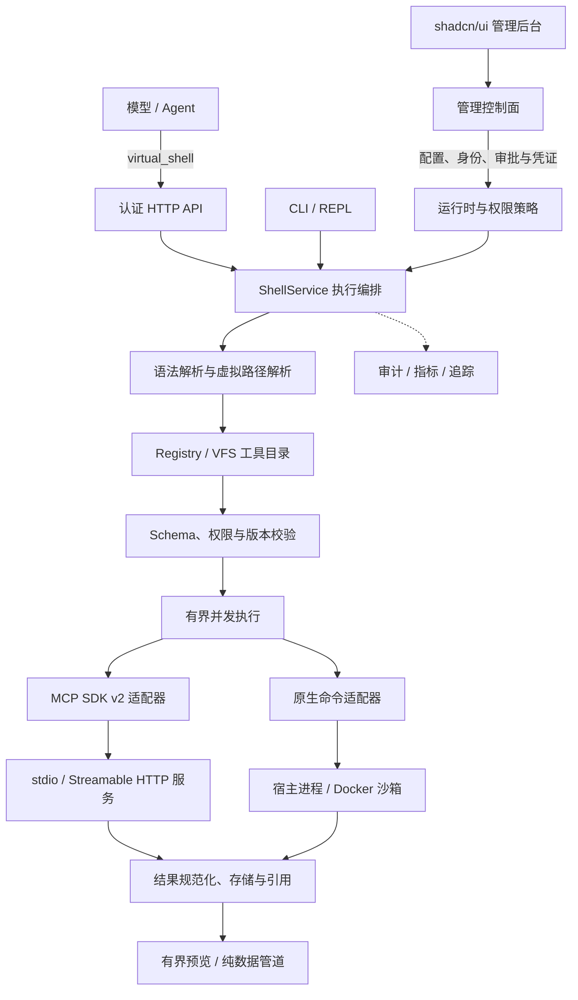
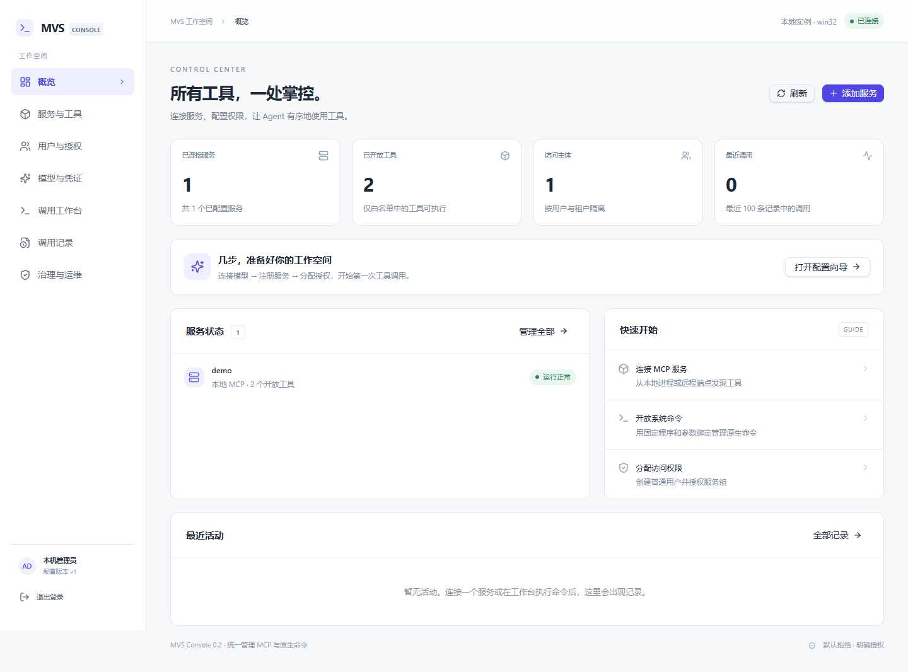
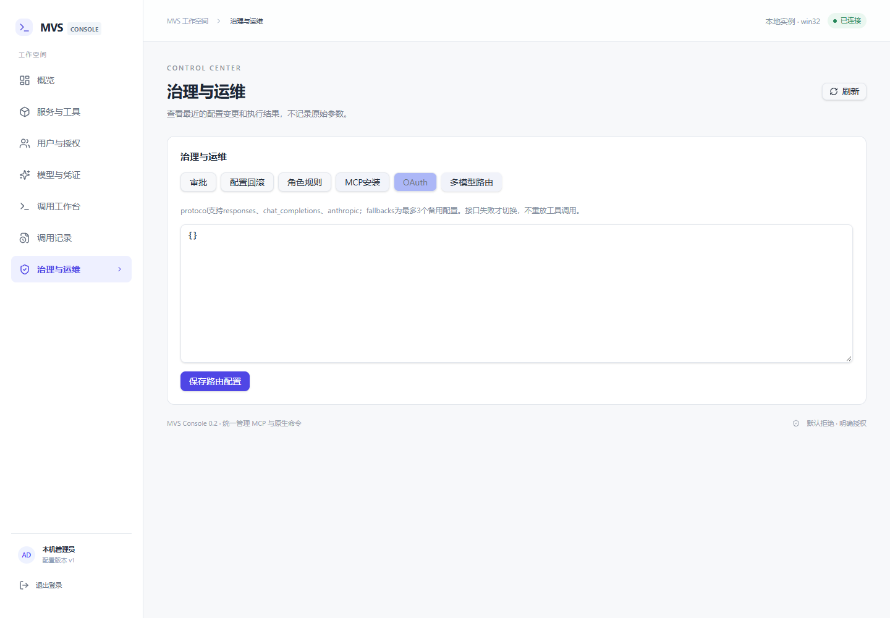

# 🐚 MCP Virtual Shell · MVS

[GitHub仓库](https://github.com/TheNorthS/MVS) · [MIT许可证](LICENSE) · [发布指南](docs/development/publishing.md)

> **面向 AI Agent 的统一工具入口与管理平台**
>
> 按需发现工具，按权限执行调用，让 MCP 服务与操作系统命令拥有一致的管理方式。

<p align="center">
  <strong>从工具目录，到可审计的实际执行</strong><br>
  MCP 工具 · 原生命令 · 渐进发现 · 参数校验 · 权限与审批 · 结果引用 · 可视化管理
</p>

<p align="center">
  
  
  
  
  
  
</p>

MVS 位于 **模型 / Agent 与实际工具之间**。模型通过一个 `virtual_shell(command)` 入口，用 `ls` 查看获授权的目录、用 `help` 读取需要的参数定义，再用 `run` 调用工具。工具规模增大时，可以按需获取定义，减少每轮向模型传入全部工具 Schema 的需求。

管理员通过中文后台统一接入 MCP 服务、注册 Linux / Windows / macOS 原生命令，配置工具白名单、用户与角色、参数约束、审批、凭证和模型。每次调用都经过相同的校验、授权、并发控制、审计与结果存储流程。

适用于维护多个 MCP 服务、向不同 Agent 分配工具权限、将现有系统脚本开放为受管工具，以及研究不同工具入口对 Token 和任务成功率的影响。内置演示 MCP 可直接体验，**无需模型密钥**；真实模型任务由所配置的模型服务执行。

**快速入口：** [安装与启动](#quickstart) · [管理后台](#console) · [接入 MCP 与系统命令](#tools) · [接入真实模型](#models) · [GPT 实验](#benchmark) · [文档索引](#docs)

---

## 📑 目录

- [✨ 项目亮点](#highlights)
- [📊 GPT 真实模型对照实验](#benchmark)
- [🏗️ 系统架构与执行流程](#architecture)
- [🖥️ 可视化管理后台](#console)
- [🚀 快速开始](#quickstart)
- [🔌 接入 MCP 与原生命令](#tools)
- [⌨️ 命令、结果与管道](#commands)
- [🤖 模型与 Agent 集成](#models)
- [🔐 权限、审批与运行边界](#security)
- [📈 审计、指标与追踪](#observability)
- [📦 部署、存储与运维](#deployment)
- [🛠️ 技术栈与项目结构](#structure)
- [🧪 测试与持续集成](#testing)
- [📚 文档索引](#docs)
- [🗺️ 当前边界与后续工作](#roadmap)
- [🤝 参与开发与许可证](#contributing)

---

<a id="highlights"></a>

## ✨ 项目亮点

| 维度               | 已实现能力                                                                                              |
| ------------------ | ------------------------------------------------------------------------------------------------------- |
| **统一工具入口**   | `/mcp` 管理 MCP 工具、资源与提示词；`/os` 管理管理员注册的系统命令；CLI、HTTP API 与 Agent 共用执行服务 |
| **渐进工具发现**   | `ls → help → run`，虚拟目录、会话当前路径、分页发现、稳定版本、手动刷新与 API 后台刷新                  |
| **参数与权限校验** | 原始 JSON Schema 校验、服务器授权、工具白名单、角色与参数规则；排队后再次核验权限和工具版本             |
| **原生命令管理**   | 固定程序、参数数组和工作目录；平台实现、路径根目录限制、输出上限、进程树清理与可选 Docker 沙箱          |
| **治理与凭证**     | 一次性审批、令牌轮换、加密凭证、配置历史回滚；OAuth 授权码 + PKCE、续期与撤销已实现并通过协议夹具测试   |
| **结果与会话**     | 有界预览、完整结果引用、所有者 / 租户隔离、分页和纯数据管道；可选 Redis、PostgreSQL 与 S3 存储          |
| **中文管理后台**   | React + TypeScript + shadcn/ui；服务、原生命令、用户、模型、凭证、工作台、调用记录与治理操作            |
| **运维与交付**     | 标准安装包、Windows 完整离线包、诊断命令、系统服务注册、更新检查与回滚、加密备份和对象修复              |
| **可观测与研究**   | 审计、OpenTelemetry、Prometheus；保留原始记录的 240 组真实 GPT 工具调用对照实验                         |

**最近验收：** 2026-11-25，接入真实 Docker 依赖的全量回归为 **170 项通过、1 项跳过，行 / 分支联合覆盖率 80.13%**。已验证两个独立 HTTP 进程共享会话、重启恢复、撤权和令牌轮换。唯一跳过项是本机 Windows 符号链接权限；真实第三方 OAuth、部分跨平台安装及长期压力验收仍待完成。[验收报告](docs/reports/validation_report.md)

---

<a id="benchmark"></a>

## 📊 真实模型对照实验

**同任务DeepSeek复测（2026-11-25）：** `deepseek-v4-pro / low`完成240组，236组成功，总用量
**2,827,348 Token**。原生多工具和JSON网关各80/80，MVS为76/80；4组达到8轮上限，无接口故障。
MVS目标调用的参数合法率75.96%，平均5.58轮，错误尝试及纠错开销均计入统计。
同任务成功配对中，MVS相对原生入口在20/50/100/200工具规模分别增加60.5%、减少9.9%、
减少33.1%、减少53.4%，配对数18/20/19/19；不能脱离成功率单看Token收益。

[DeepSeek完整报告](artifacts/benchmarks/deepseek-240-20261125-194449-v0.0.1/report.md) ·
[GPT完整报告](artifacts/benchmarks/gpt-240-20261125-185218-v0.0.1/report.md)

以下保留GPT结果。两轮任务、目录、提示词和显式限制一致；不同模型的分词及接口细节存在差异，
跨模型Token不直接等于费用或能力差异。

**2026-11-25，0.0.1：240/240组任务成功，有效执行总用量1,681,974 Token。** 工具选择准确率、参数合法率和参数正确率均为100%。

模型实际完成工具发现、选择、参数构造、调用与最终回答。三个入口共用真实MCP和相同执行后端，在20 / 50 / 100 / 200工具规模下各执行同一批20个任务；请求模型为`gpt-6-astra / low`。

| 入口        | 模型初始看到什么         | 发现与调用             |
| ----------- | ------------------------ | ---------------------- |
| 原生多工具  | 当前目录的全部函数Schema | 选择函数并构造JSON参数 |
| JSON网关    | 一个`mcp_gateway`        | `list / help / call`   |
| MVS虚拟命令 | 一个`virtual_shell`      | `ls / help / run`      |

| 工具规模 | 配对任务数 | MVS相对原生入口Token变化 | MVS相对JSON网关Token变化 |
| -------- | ---------: | -----------------------: | -----------------------: |
| 20       |         20 |            **增加66.6%** |                 增加1.7% |
| 50       |         20 |                 减少8.0% |                减少34.0% |
| 100      |         20 |                减少34.0% |                减少49.1% |
| 200      |         20 |                减少47.5% |                减少57.9% |

小目录下额外发现轮次增加成本；较大目录中按需读取工具定义降低累计Token。原生多工具平均2.00轮，JSON网关4.00轮，MVS为4.03轮。

统计只使用每个任务的有效完整执行，HTTP 502和网络超时作为接口异常不计入能力评分；工具选择、参数和答案错误仍属于任务失败。Token、轮次、上下文增长与延迟都使用同一批240条记录。原始调用数据保留用于核对，评测用量不代表整次运行账单。

任务为合成只读单步业务，每个组合仅20任务，没有独立重复采样或显著性检验；结果不能推广到所有模型与复杂生产任务。

<details>
<summary><strong>复现方式</strong></summary>

先设置`OPENAI_API_KEY`、`OPENAI_BASE_URL`，并选择账号可用模型。以下命令会实际调用模型接口，使用新输出目录保留原始记录：

```bash
uv run mvs-benchmark --model "<可用模型ID>" --sizes 20 200 --tasks 1 --output artifacts/benchmarks/gpt-smoke-new
uv run mvs-benchmark --model "<可用模型ID>" --tasks 20 --concurrency 4 --output artifacts/benchmarks/gpt-240-new
```

</details>

[GPT实验报告](artifacts/benchmarks/gpt-240-20261125-185218-v0.0.1/report.md) · [实验方法](docs/research/model_benchmark.md) · [本地路由微基准](docs/research/benchmarks.md)

---

<a id="architecture"></a>

## 🏗️ 系统架构与执行流程



一次 `run` 调用依次完成：解析命令 → 解析目录与工具 → 转换并校验参数 → 校验授权 → 等待并发名额 → 复核权限与工具版本 → 调用后端 → 保存完整结果 → 返回预览和引用。

| 组件                      | 职责                                                                     |
| ------------------------- | ------------------------------------------------------------------------ |
| `Registry / VFS`          | 保存工具元数据、发布目录快照，按身份过滤可见内容                         |
| `SchemaAdapter / Policy`  | 将命令参数转换为工具参数，并检查原始 Schema、服务器授权和细粒度规则      |
| `ShellService / Executor` | 编排会话、审批、并发、截止时间、工具调用与结果转换                       |
| MCP / Native 适配器       | 分别管理协议连接和原生进程；MCP SDK 生产导入集中在 `infrastructure/mcp/` |
| 管理控制面                | 管理身份与配置版本；配置切换等待在途请求，保留仍有效的会话和当前目录     |
| 存储与观察接口            | 保存受所有权保护的结果、会话状态与调用证据，可切换外部后端               |

工具描述、提示词和结果作为不可信数据返回。`TIMEOUT_UNCERTAIN` 表示下游可能已经执行，MVS 不自动重放工具调用。[架构契约](docs/reference/architecture.md) · [0.0.1 运行与治理说明](docs/guides/production_features.md)

---

<a id="console"></a>

## 🖥️ 可视化管理后台

后台随发布 wheel 安装，最终用户无需安装 Node.js。默认通过 `http://127.0.0.1:8080` 访问，使用本机初始化产生的管理员令牌登录。



| 管理内容         | 用户可以进行的操作                                                                  |
| ---------------- | ----------------------------------------------------------------------------------- |
| MCP 服务         | 新增、编辑、启停、连接发现、刷新目录、选择工具白名单；安装固定版本 Git / Fetch 模板 |
| 原生命令         | 配置平台程序、固定参数、参数 Schema、工作目录和路径限制                             |
| 用户与角色       | 分配服务和工具权限、限制参数、管理令牌、禁用或撤销访问                              |
| 模型与凭证       | 配置端点、模型、协议、凭证引用和故障切换；托管密钥不通过读取接口回显                |
| 命令与模型工作台 | 手动调用工具，或由模型完成发现和执行；查询自己的结果                                |
| 治理与运维       | 审批、OAuth 配置、配置版本和历史回滚、调用事件查询                                  |

<details>
<summary><strong>查看治理页面</strong></summary>



</details>

第一次使用建议按顺序完成：**初始化并登录 → 查看 demo 工具 → 执行加法 → 新建普通用户并授权 → 配置真实 MCP 或原生命令 → 用普通用户令牌接入 Agent**。模型任务走同一执行 API，不能绕过后台设置的权限。[安装与管理教程](docs/guides/user_installation.md) · [管理 API](docs/reference/management_api.md)

---

<a id="quickstart"></a>

## 🚀 快速开始

当前版本 **0.0.1** 已发布到[PyPI](https://pypi.org/project/mcp-virtual-shell/0.0.1/)，可直接安装包含中文后台的工具：

```bash
uv tool install --python 3.12 'mcp-virtual-shell[console]==0.0.1'
mvs init
mvs token show
mvs serve --open
```

已有Python虚拟环境也可使用`python -m pip install 'mcp-virtual-shell[console]==0.0.1'`。

版本暂时固定为0.0.1；历史报告保留当时的开发标签。目录分类与版本维护规则见[维护约定](docs/development/repository_layout.md)。

| 使用方式             | 所需环境                                 | 适用场景                                          |
| -------------------- | ---------------------------------------- | ------------------------------------------------- |
| PyPI安装（推荐）     | uv，或Python 3.12+虚拟环境               | 直接从公开索引安装当前版本                        |
| 标准安装 ZIP         | 联网下载 Python / uv / 依赖              | 在其他用户机器上安装 CLI 与内置后台               |
| Windows 完整离线 ZIP | 匹配的 Windows x86_64 环境               | 包内携带 Python、uv 和核心 / 控制台依赖，离线安装 |
| 源码 CLI             | Python 3.12+、uv                         | 开发、调试和命令行体验                            |
| 源码后台             | 上述环境及 Node.js 22 / npm              | 构建或修改前端页面                                |
| 外部存储 / 容器      | `production` 可选依赖 / 可用 Docker 引擎 | 共享存储或命令沙箱；基础 demo 不需要              |

### 方式一：标准安装包

解压 `mcp_virtual_shell-0.0.1-installer.zip`，进入解压目录，按平台执行：

```powershell
# Windows PowerShell 5.1 / 7
.\scripts\install.ps1
```

```bash
# Linux / macOS
sh scripts/install.sh
```

脚本安装本地 wheel、准备 Python 3.12 工具环境并运行 `mvs init`。随后：

```bash
mvs token show
mvs serve --open
```

把第一条命令显示的管理员令牌粘贴到登录页。若 `mvs` 尚未进入 PATH，使用安装脚本打印的完整路径，或运行 `uv tool update-shell` 后重新打开终端。

已有 Python / uv 的用户也可以在 wheel 所在目录手动安装：

```bash
uv tool install --python 3.12 './mcp_virtual_shell-0.0.1-py3-none-any.whl[console]'
mvs init
mvs doctor
```

### 方式二：Windows 完整离线包

解压 `offline-windows-0.0.1.zip`，在解压目录运行：

```powershell
.\install.cmd
```

安装会核对文件哈希，并使用包内 Python、uv 和依赖 wheel；**安装后需保留包内 `python` 目录**，工具环境仍引用该解释器。本地验收已在独立工具目录、空缓存和禁止访问索引的条件下成功安装 39 个依赖。外部存储的 `production` 依赖需另行准备。

### 方式三：从源码运行

在仓库根目录安装锁定依赖，直接体验真实演示 MCP：

```bash
uv sync --locked --all-extras
uv run mvs repl
```

在 `mvs:` 提示符中输入：

```text
ls /mcp/demo/tools
help /mcp/demo/tools/add
run /mcp/demo/tools/add --a 10 --b 20
exit
```

加法结果为 `30`。CLI 自动启动演示 MCP 服务，不需要另开服务终端或配置模型。

从源码使用可视化后台时，先构建页面，再初始化实例：

```bash
npm --prefix web ci
npm --prefix web run build
uv run mvs init
uv run mvs token show
uv run mvs serve --open
```

### 实例目录与服务器访问

| 系统    | 默认数据目录                                          |
| ------- | ----------------------------------------------------- |
| Windows | `%LOCALAPPDATA%\MVS`                                  |
| Linux   | `$XDG_DATA_HOME/mvs`；未设置时为 `~/.local/share/mvs` |
| macOS   | `~/Library/Application Support/MVS`                   |

用 `MVS_HOME` 或 `--home` 选择独立实例；后续命令应使用同一目录：

```bash
mvs init --home /srv/mvs-data
mvs serve --home /srv/mvs-data
```

无桌面的 Linux 服务器可用 SSH 隧道访问后台：`ssh -N -L 8080:127.0.0.1:8080 user@server`。公网部署需要 HTTPS 反向代理和正确的 `MVS_ALLOWED_HOSTS`；`mvs serve` 只监听回环地址。[Linux 部署与真实模型接入](docs/guides/linux_deployment.md)

---

<a id="tools"></a>

## 🔌 接入 MCP 与原生命令

### MCP 服务

可在后台维护服务，也可为 CLI / 独立 API 提供 YAML。以下是内置演示的最小配置：

```yaml
servers:
    - id: demo
      transport: stdio
      command: python
      args: ["-m", "mvs.infrastructure.mcp.demo_server"]
      enabled: true
      allowed_tools: [add, echo]
      connect_timeout_seconds: 30
      call_timeout_seconds: 15
      max_concurrency: 2
```

`command: python` 使用当前项目解释器。可信配置决定启动什么程序；模型命令不能修改启动参数。Streamable HTTP 服务则配置 `url`、`http_allowed_hosts` 和凭证引用：

```yaml
servers:
    - id: research
      transport: streamable_http
      url: "https://mcp.example.com/mcp"
      http_allowed_hosts: ["mcp.example.com"]
      auth_ref: MVS_RESEARCH_TOKEN
      enabled: true
      allowed_tools: [search]
```

将示例端点和工具替换为实际服务。`auth_ref` 引用凭证，不写入明文 token；受管 OAuth 使用 `oauth:提供方名`。管理员还需将服务授权给对应用户，**服务白名单本身不会授予用户访问权**。

配置模板：[基础 MCP](configs/servers.example.yaml) · [Linux Git MCP](configs/servers.linux.example.yaml)。已有 YAML 可在停止管理实例后用 `mvs config import 文件路径` 合并导入。

### Linux、Windows 与 macOS 原生命令

原生命令组使用 `transport: native`，工具位于 `/os/<分组>/tools/<名称>`。管理员固定程序绝对路径、工作目录、参数模板及 Schema，模型只填写获准的参数值。

| 系统    | 平台键   | 示例程序                                                         |
| ------- | -------- | ---------------------------------------------------------------- |
| Linux   | `linux`  | `/bin/hostname`、`/usr/bin/id`、管理员固定 Bash 脚本             |
| Windows | `win32`  | `hostname.exe`、`whoami.exe`、管理员固定 PowerShell `-File` 脚本 |
| macOS   | `darwin` | `/bin/hostname`、`/usr/bin/id`、管理员固定脚本                   |

通过仓库配置直接读取本机主机名和进程身份：

```bash
uv run mvs --config configs/servers.native.example.yaml --json exec -- 'run /os/host/tools/hostname'
uv run mvs --config configs/servers.native.example.yaml --json exec -- '/os/host/tools/identity'
```

配置只选择运行主机对应的平台实现。动态参数绑定为独立 `argv` 元素；不执行模型拼接的 `sh -c`、PowerShell `-Command`、重定向或命令替换。`path_roots` 可限制文件参数的允许目录；宿主执行使用 MVS 服务账户权限，需要更强文件系统与网络隔离时配置 Docker 沙箱。

[原生命令配置与固定脚本教程](docs/guides/native_commands.md) · [容器沙箱与真实验收](docs/guides/docker_acceptance.md)

---

<a id="commands"></a>

## ⌨️ 命令、结果与管道

### 目录发现与调用

```text
pwd
ls /mcp
ls /os
ls /mcp/demo/tools
help /mcp/demo/tools/add
run /mcp/demo/tools/add --a 2 --b 3
/mcp/demo/tools/add --params-json '{"a":2,"b":3}'
cd /mcp/demo/tools
run add --a -3 --b 5
./echo --text "hello world"
```

`cd` 只改变会话的虚拟路径。`run add` 按当前目录解析，裸名称 `add` 不自动调用。参数支持 `--a=1`、`--a 1`、类型转换和 JSON 整体透传；复杂联合类型使用 `--params-json`，与分项参数互斥。重复参数、未知参数和非法类型会被拒绝。

一次性执行和机器可读响应：

```bash
uv run mvs --audit --json exec -- 'run /mcp/demo/tools/add --a 2 --b 3'
```

响应包含 `request_id`、`session_id`、`status`、`exit_code`、`stdout`、`stderr`、`data`、`result_ref`、`truncated`、`duration_ms` 和 `error`。加法结构化数据保留 `{"result":5}`，标准输出为 `5`。

### 完整结果引用

工具结果持久化后返回 `/results/<随机ID>`，模型先读取有界预览，需要时再取完整内容。同一租户和主体可跨会话读取未过期结果；知道结果 ID 不能绕过所有权检查。

```text
run /mcp/demo/tools/add --a 2 --b 3 | select result
cat /results/<实际返回的ID>
cat /results/<数组结果ID> --offset 0 --limit 100
cat /results/<数组结果ID> | where stars gt 10 | sort stars --desc | head -n 5
```

管道只执行有界数据变换，支持 `select / where / sort / head / count`；`run toolA | run toolB` 会被拒绝，避免隐式发起第二次外部调用。分页接受顶层数组或纯文本，嵌套数组需要先按结果结构投影。

资源、资源模板和提示词使用独立目录与白名单：

```text
ls /mcp/demo/resources
ls /mcp/demo/resource_templates
ls /mcp/demo/prompts
prompt /mcp/demo/prompts/welcome --name Alice
```

资源 URI 编码为虚拟节点名，不作为宿主文件路径读取。[完整命令语言](docs/reference/command_language.md)

---

<a id="models"></a>

## 🤖 模型与 Agent 集成

MVS 提供工具执行与治理层；模型负责规划、选择工具和组织答案。可以在后台配置模型并使用模型工作台，也可以从已有 Agent 通过 HTTP 接入，或使用框架无关的 [单工具适配示例](examples/agent_adapter.py)。

### 使用内置模型客户端

先在后台创建普通用户、授权服务并取得用户令牌。保持 `mvs serve` 运行，在另一个 PowerShell 终端设置：

```powershell
$env:MVS_API_URL = 'http://127.0.0.1:8080'
$env:MVS_AGENT_TOKEN = '<后台创建的普通用户令牌>'
$env:OPENAI_BASE_URL = 'https://api.openai.com/v1'
$env:OPENAI_API_KEY = '<模型接口密钥>'
mvs-agent --model '<账号可用的模型ID>' --task '找到加法工具，计算 12 加 30，并给出结果'
```

从源码运行时将最后一行替换为 `uv run mvs-agent ...`；Linux / macOS 使用 `export 变量名='值'` 设置环境变量。示例会真实调用模型接口，模型端点、凭据和模型 ID 必须匹配。

| 协议                      | CLI 选项 / 后台 `model.protocol` |
| ------------------------- | -------------------------------- |
| OpenAI Responses          | `responses`，默认                |
| Chat Completions 兼容接口 | `chat_completions`               |
| Anthropic 兼容接口        | `anthropic`                      |

CLI 使用 `--protocol` 选择协议。兼容协议客户端沿用上述 `OPENAI_BASE_URL` / `OPENAI_API_KEY` 配置入口。客户端限制模型轮次与工具调用数；遇到审批或不确定执行结果时停止自动循环。后台可配置暂时错误的模型故障切换，工具调用不会因此被重放。

### 集成现有 Agent

所有业务接口通过 `Authorization: Bearer <用户令牌>` 认证，主体与租户由令牌确定，请求体不能自行声明身份。

| API                                               | 用途                           |
| ------------------------------------------------- | ------------------------------ |
| `POST /api/v1/sessions`，请求体 `{}`              | 创建属于当前主体的会话         |
| `POST /api/v1/shell/execute`                      | 提交 `session_id` 与 `command` |
| `DELETE /api/v1/sessions/{id}`                    | 关闭自己的会话                 |
| `GET /api/v1/servers`                             | 查询当前主体可见服务           |
| `POST /api/v1/servers/{id}/refresh`               | 管理员刷新已获授权服务的目录   |
| `GET /api/v1/health/live`、`/api/v1/health/ready` | 存活与依赖就绪检查             |
| `GET /metrics`                                    | 管理员读取 Prometheus 指标     |

执行请求体示例：

```json
{
    "session_id": "<创建会话后返回的ID>",
    "command": "run /mcp/demo/tools/add --a 12 --b 30"
}
```

模型只需一个接收 `command` 字符串的函数定义；响应应标为 `untrusted_tool_data`，不自动执行返回内容中的建议。[真实 GPT 客户端](examples/gpt_agent.py) · [自定义 API 部署入口](examples/deploy_api.py) · [完整接入教程](docs/guides/linux_deployment.md)

---

<a id="security"></a>

## 🔐 权限、审批与运行边界

**发现、执行与结果读取都受权限约束。** 工具目录按身份过滤，调用必须同时满足服务授权、工具白名单、角色 / 用户规则和参数限制；执行器在获得并发名额后再次检查权限与工具版本。

| 环节        | 当前处理方式                                                                                |
| ----------- | ------------------------------------------------------------------------------------------- |
| 身份与令牌  | 服务端确定主体 / 租户；令牌以摘要保存，支持轮换、禁用和撤销                                 |
| 审批        | 受管后台创建、查看、批准或拒绝请求；批准绑定主体、租户、工具版本与参数，派发前一次性消费    |
| 凭证        | Fernet 加密托管值；可使用文件密钥、`MVS_VAULT_KEY` 或可选系统钥匙串；凭证读取接口不回显明文 |
| OAuth       | 授权码 + PKCE、一次性 state、用户隔离、续期与撤销；真实身份提供方仍需单独验收               |
| 原生进程    | 固定程序与参数绑定、输出限制、Windows Job / POSIX 进程组清理，可配置 CPU / 内存限制         |
| Docker 沙箱 | 预先准备的镜像，默认禁网络、只读根和挂载、非 root、移除 capabilities、限制 CPU / 内存 / PID |
| HTTP MCP    | 主机白名单与 IP 检查，在连接点使用已检查数字 IP，保留 Host 与 TLS SNI                       |
| 不可信计算  | `MVS_ISOLATED_VALIDATION=1` 将 Schema 校验及管道工作交给有资源限制的独立进程                |

审批不是工具已经执行的证明；获批后需携带 `approval_id` 重交原命令，超时不会返还已消费批准。配置回滚保留当前身份令牌，避免恢复旧令牌。程序白名单和路径参数校验不能替代操作系统隔离；可读取主密钥和数据库的主机管理员仍属于信任边界。

<details>
<summary><strong>常用默认限制</strong></summary>

| 项目                    | 默认限制                                            |
| ----------------------- | --------------------------------------------------- |
| 命令长度 / 语法词项     | 16 KiB / 256                                        |
| 路径长度 / JSON 深度    | 4096 字节 / 32 层                                   |
| 参数 / 单条结果         | 64 KiB / 4 MiB                                      |
| 结果存储配额 / 反馈预览 | 64 MiB / 8 KiB                                      |
| 管道                    | 最多 8 阶段、10,000 行；`head` 与分页最多 1000 条   |
| 会话 / 结果有效期       | 1 小时                                              |
| 会话工具调用次数        | 100 次                                              |
| Shell 截止时间          | 30 秒，另有服务与原生命令超时；退出清理可能继续执行 |
| 原生命令输出            | 256 KiB，可配置                                     |
| Docker 资源             | 256 MiB、1 个 CPU 核、64 个 PID；内存可配置         |

</details>

[生产权限与隔离说明](docs/guides/production_features.md) · [安全设计](docs/reference/security.md)

---

<a id="observability"></a>

## 📈 审计、指标与追踪

API、Shell 与工具执行建立关联追踪。审计记录请求标识、主体、版本、耗时和结果类别；不记录原始命令或参数值。Prometheus 标签保持有界，不包含用户、租户、会话 ID、查询文本或凭证。

| 指标                                                                     | 用途                         |
| ------------------------------------------------------------------------ | ---------------------------- |
| `mvs_shell_requests_total` / `mvs_shell_duration_seconds`                | Shell 请求数与耗时           |
| `mvs_tool_calls_total` / `mvs_tool_duration_seconds`                     | 实际 MCP 调用数与耗时        |
| `mvs_native_command_calls_total` / `mvs_native_command_duration_seconds` | 原生命令执行尝试数与耗时     |
| `mvs_registry_refresh_total` / `mvs_registry_refresh_duration_seconds`   | 工具目录刷新次数、状态与耗时 |
| `mvs_result_bytes_total`                                                 | 成功持久化的结果字节累计量   |
| `mvs_policy_denials_total`                                               | 权限拒绝次数与原因           |

语法、Schema 或授权拒绝不会计成已派发的工具调用；普通目录权限过滤不计拒绝。超时和取消分别统计，结果字节累计量不等于当前磁盘用量。多个进程应分别采集再聚合；示例 OTel 控制台导出器可按部署需要替换。[指标口径、采集与 PromQL](docs/reference/observability.md)

---

<a id="deployment"></a>

## 📦 部署、存储与运维

### 从单机到共享存储

| 模式       | 组件与适用方式                                                         |
| ---------- | ---------------------------------------------------------------------- |
| 本地单实例 | 私有实例目录、SQLite 控制状态 / 结果元数据、本地对象文件、内存会话     |
| 共享存储   | Redis 会话 / 锁 / 限流，PostgreSQL 控制状态与结果，可选 S3 内容存储    |
| 容器命令   | 在上述部署基础上启用 `sandbox_image`；Docker daemon 负责解释挂载源路径 |

从源码启用生产适配依赖：`uv sync --locked --extra console --extra production`。安装 wheel 时选择 `[console,production]`；基础安装器默认只安装控制台所需依赖。

| 环境变量                                      | 用途                                 |
| --------------------------------------------- | ------------------------------------ |
| `MVS_REDIS_URL`                               | 共享会话、会话锁与限流               |
| `MVS_POSTGRES_DSN`                            | 结果元数据与事务配额                 |
| `MVS_CONTROL_POSTGRES_DSN`                    | 共享配置、用户、审批、OAuth 与事件   |
| `MVS_VAULT_KEY`                               | 多节点一致的凭证加密主密钥           |
| `MVS_S3_BUCKET` / `MVS_S3_ENDPOINT`           | 独立对象桶与 S3 兼容端点             |
| `AWS_ACCESS_KEY_ID` / `AWS_SECRET_ACCESS_KEY` | S3 凭证；也可使用 boto3 标准凭证配置 |

多节点使用不同本地 `--home` 目录、同一共享配置和主密钥。同机双进程功能测试已验证会话、结果和撤权传播；这不等于跨物理机容灾或生产容量承诺。

### 维护命令

```bash
mvs doctor
mvs config export servers-backup.yaml
mvs backup create backup.mvsb
mvs backup restore backup.mvsb --home /path/to/empty-instance
mvs repair
```

备份交互输入密码并加密归档；恢复目标必须为空目录。离线维护前停止对应实例，外部 PostgreSQL / Redis / S3 使用各自原生备份设施。`mvs repair` 核对结果对象，清理孤立内容并报告丢失对象。

系统服务入口为 `mvs service install` / `uninstall`，对应 Linux 用户级 systemd、macOS launchd 和 Windows 登录任务。更新入口为 `mvs update check/install --url <HTTPS清单地址>`，并提供 `status` / `rollback`；目前需要维护者提供发布地址，尚无无人值守升级调度。

维护者通过 `python scripts/build_release.py` 构建 wheel 和标准 ZIP，通过 `scripts/full_offline_bundle.py` 为当前平台打包独立 Python 与依赖。已有本地 Windows 离线包；Linux / macOS 完整离线安装和系统服务仍待目标环境验收。

[生产配置与运维细节](docs/guides/production_features.md) · [Linux 部署](docs/guides/linux_deployment.md) · [真实 Docker 验收](docs/guides/docker_acceptance.md)

---

<a id="structure"></a>

## 🛠️ 技术栈与项目结构

| 层次         | 技术                                                                |
| ------------ | ------------------------------------------------------------------- |
| 核心与协议   | Python 3.12+、官方 MCP Python SDK v2（当前锁定 2.3.0）、JSON Schema |
| API 与控制面 | FastAPI、Uvicorn、SQLite、cryptography                              |
| 管理后台     | React 19、TypeScript、Vite、Tailwind CSS、shadcn/ui、Radix、Lucide  |
| 可选存储     | Redis、PostgreSQL / psycopg、S3 / boto3                             |
| 观察与质量   | OpenTelemetry、Prometheus、pytest、Ruff、mypy、Playwright           |
| 构建与依赖   | uv / uv.lock、npm / package-lock.json、wheel、GitHub Actions        |

```text
mcp-virtual-shell/
├── src/mvs/
│   ├── parser/                  # 命令词法、语法与 AST
│   ├── core/                    # Registry、VFS、Schema 与结果规范化
│   ├── services/                # 统一执行编排
│   ├── security/                # 权限、审计、审批、OAuth 与凭证
│   ├── infrastructure/
│   │   ├── mcp/                 # 官方 SDK 适配与真实演示服务
│   │   ├── native/              # 原生命令、进程隔离与 Docker 后端
│   │   └── storage/             # 本地与外部存储
│   ├── management/              # 管理 API、配置切换、备份、更新与安装
│   ├── api/                     # Agent 执行 API
│   ├── pipeline/                # 有界纯数据转换
│   ├── models/                  # 模型协议适配与故障切换
│   └── benchmarks/              # 真实模型实验与统计
├── web/                         # shadcn/ui 控制台源码与浏览器测试
├── configs/                     # MCP、Linux 与原生命令配置示例
├── examples/                    # Agent、API 与固定脚本示例
├── tests/                       # 单元、集成、安全和端到端测试
├── scripts/                     # 安装、构建、离线包和 Docker 验收
├── deploy/                      # 服务部署示例
├── artifacts/
│   ├── benchmarks/              # GPT实验与本地路由微基准原始数据
│   ├── tests/                   # JUnit与覆盖率记录
│   └── security/                # 依赖审计与许可证报告
├── docs/
│   ├── guides/                  # 安装、部署、接入与运维教程
│   ├── reference/               # 架构、命令语言、API和安全契约
│   ├── research/                # 实验方法与统计口径
│   ├── development/             # 目录约定、实施决策与完成状态
│   ├── reports/                 # 人类可读的验收报告
│   └── assets/                  # 文档使用的控制台截图
└── dist/                        # 本地分发产物；archive保存旧构建
```

依赖版本以 [pyproject.toml](pyproject.toml)、[前端依赖](web/package.json)及对应锁文件为准。

---

<a id="testing"></a>

## 🧪 测试与持续集成

### 本地开发检查

```bash
uv sync --locked --all-extras
uv run ruff check .
uv run mypy
uv run pytest -q
uv run pytest --cov=src/mvs --cov-branch --cov-report=term-missing
```

pytest 不调用付费模型。模型与 OAuth 协议使用受控响应验证；MCP、原生进程与可选 Docker 测试实际执行对应后端。需要外部环境但未配置时，测试会明确跳过。

SDK v1 ↔ v2 兼容与 Git MCP 测试使用隔离夹具；生产依赖仍为 SDK v2。CI 中的准备方式也可用于本地：

```powershell
uv venv .tools/legacy
uv pip install --python .tools/legacy/Scripts/python.exe mcp==1.30.0
uv venv .tools/git-mcp
uv pip install --python .tools/git-mcp/Scripts/python.exe mcp-server-git==2026.11.11
```

Linux / macOS 将 `Scripts/python.exe` 改为 `bin/python`。前端修改使用 `npm --prefix web run build`；浏览器测试需要先启动独立测试后台，配置见 [CI 工作流](.github/workflows/ci.yml)。

### 真实外部依赖验收

Docker 引擎可用且已准备测试镜像后：

```bash
uv run python scripts/test_docker.py
uv run python scripts/test_docker.py --coverage tests
```

脚本创建独立 Redis、PostgreSQL、MinIO 容器，使用临时端口和测试数据，退出后清理自己创建的资源。镜像准备、已有镜像覆盖参数与报告路径见 [Docker 验收教程](docs/guides/docker_acceptance.md)。

| 检查                      | 最近已记录结果（2026-11-25）                                       |
| ------------------------- | ------------------------------------------------------------------ |
| 接入真实依赖的全量 pytest | **170 通过、1 跳过，173.16 秒**；跳过为 Windows 符号链接权限       |
| 行 / 分支联合覆盖率       | **80.13%**；语句覆盖率 83.05%，分支覆盖率 71.07%                   |
| Docker 专项               | **12 通过、零跳过**；存储、双进程、重启恢复、权限传播与沙箱        |
| 静态检查与构建            | Ruff、mypy（66 个源码文件）、TypeScript / Vite 构建通过            |
| 离线分发                  | 3486 个清单文件哈希与 ZIP CRC 核验；空缓存离线安装及 `doctor` 通过 |

这些是已记录的验收数据，修改文档不代表重新执行了全部测试。覆盖率不包含独立 HTTP / MCP 子进程的额外执行。[完整验收记录](docs/reports/validation_report.md) · [全量 JUnit](artifacts/tests/docker-full-regression-2026-11-25.xml) · [Docker 专项 JUnit](artifacts/tests/docker-acceptance-2026-11-25.xml)

### CI 配置

| 工作流                                                 | 配置的检查范围                                                                      |
| ------------------------------------------------------ | ----------------------------------------------------------------------------------- |
| [常规检查](.github/workflows/ci.yml)                   | Windows / Linux / macOS、Python 3.12 / 3.13；静态检查、pytest、前端构建与浏览器测试 |
| [外部集成](.github/workflows/external-integration.yml) | Redis、PostgreSQL、S3 与 Docker 沙箱验收及报告归档                                  |
| [依赖安全](.github/workflows/security.yml)             | Python / npm 漏洞审计、许可证清单与检查                                             |
| [发布](.github/workflows/release.yml)                  | 手动构建、GitHub 草稿发布、可选 PyPI 可信发布                                       |

工作流文件已提供；远程 CI 成功与公共发布需在实际仓库执行后确认，当前不把本地结果当作远程通过证明。

---

<a id="docs"></a>

## 📚 文档索引

完整分类导航见[docs/README.md](docs/README.md)，原始实验与报告见[产物索引](artifacts/README.md)。

| 目标                               | 文档                                                                                                                                                                  |
| ---------------------------------- | --------------------------------------------------------------------------------------------------------------------------------------------------------------------- |
| 安装给其他用户、使用管理后台       | [安装与管理](docs/guides/user_installation.md)、[生产能力说明](docs/guides/production_features.md)                                                                    |
| 在 Linux 上接入真实模型和 MCP      | [Linux 部署教程](docs/guides/linux_deployment.md)                                                                                                                     |
| 暴露系统程序或固定脚本             | [原生命令教程](docs/guides/native_commands.md)                                                                                                                        |
| 编写命令、读取结果、使用管道       | [命令语言](docs/reference/command_language.md)                                                                                                                        |
| 集成管理接口                       | [管理 API](docs/reference/management_api.md)                                                                                                                          |
| 配置 OAuth、审批、存储、备份与升级 | [生产能力与边界](docs/guides/production_features.md)                                                                                                                  |
| 理解模块与接口契约                 | [架构](docs/reference/architecture.md)、[实施决策](docs/development/implementation_decisions.md)、[原始实施规范](docs/MCP_Virtual_Shell_Codex_Implementation_Spec.md) |
| 采集指标与追踪                     | [可观测性](docs/reference/observability.md)                                                                                                                           |
| 复现 GPT 实验                      | [实验方法](docs/research/model_benchmark.md)、[完整结果](artifacts/benchmarks/gpt-240-20261125-185218-v0.0.1/report.md)                                               |
| 运行真实服务验收                   | [Docker 验收](docs/guides/docker_acceptance.md)                                                                                                                       |
| 核对完成状态与历史结果             | [完成跟踪](docs/development/completion_tracker.md)、[验收报告](docs/reports/validation_report.md)、[变更记录](docs/CHANGELOG.md)                                      |

---

<a id="roadmap"></a>

## 🗺️ 当前边界与后续工作

核心 MCP 执行、管理后台、原生命令、审批、外部存储与多实例功能已有代码和对应测试。下面区分尚待验收的能力与尚未实现的交付项：

| 项目                 | 当前状态与后续工作                                                                         |
| -------------------- | ------------------------------------------------------------------------------------------ |
| 真实第三方 OAuth     | 协议夹具已通过；仍需身份提供方的客户端、回调与实际授权生命周期验收                         |
| 跨平台安装与服务     | Windows 完整离线安装已实测；Linux / macOS 完整离线包、服务注册和 GUI 安装仍需目标环境验证  |
| 安装器交付           | 已有脚本和 Python GUI 入口；尚未交付经过签名与完整验收的 MSI / 平台安装应用                |
| 多实例生产容错       | 同机双进程功能通过；长期压力、跨机器网络故障、异常退出与数据库故障恢复仍需验证             |
| Redis 与长请求       | 同步接口可能阻塞事件循环；长请求锁租期与生产容量仍需专项改进及测试                         |
| 自动升级与数据库降级 | 已有显式检查、安装和 wheel 回滚；无人值守升级调度与任意版本数据库降级尚未完成              |
| 细粒度权限与资源隔离 | 权限 Schema 采用受限子集；进程限制和容器行为依赖目标系统，不能等同于全部部署环境的隔离保证 |
| 公共发布             | GitHub源码仓库为TheNorthS/MVS；0.0.1已发布至PyPI，后续可信发布配置见发布指南               |

真实模型实验也仅覆盖当前模型接口与合成任务集，后续仍需复杂多步任务、多模型和重复采样，才能评价更广泛的收益。[逐项完成跟踪](docs/development/completion_tracker.md)

---

<a id="contributing"></a>

## 🤝 参与开发与许可证

开发变更应遵循现有分层：MCP SDK 调用保留在适配层，命令解析与权限策略不依赖 SDK；新增后端复用统一授权、审计和结果约束。修改行为时补充对应测试与中文文档，记录真实失败和未验收部分，不以模拟结果替代外部验收。

提交前运行相关 pytest、Ruff 与 mypy；前端修改同时检查生产构建及浏览器流程。不要提交模型密钥、访问令牌、真实服务配置或用户数据；真实模型实验由明确命令单独启动。

项目采用[MIT许可证](LICENSE)，版权归TheNorthS。第三方许可说明见[NOTICE](NOTICE)，
shadcn/ui原始声明保存在[组件许可文件](web/public/licenses/shadcn-ui.txt)。
参与方式见[贡献指南](CONTRIBUTING.md)，维护者发布步骤见[GitHub与PyPI发布指南](docs/development/publishing.md)。
