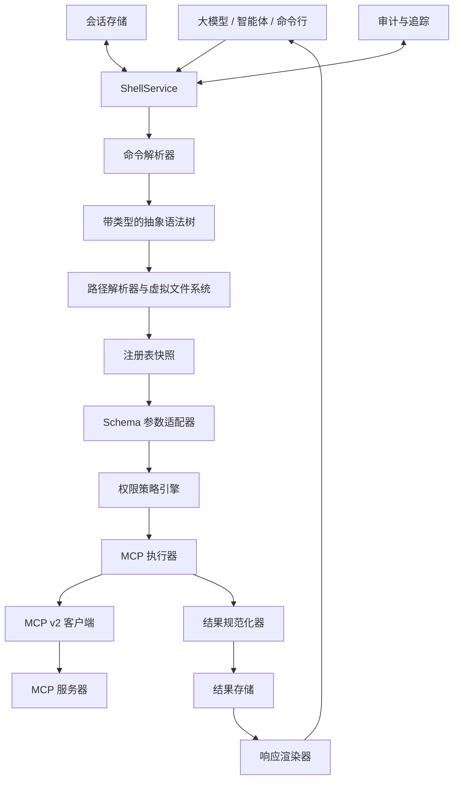

# MCP Virtual Shell（MVS）完整工程设计与 Codex 实施规范

> **2026-11-23 范围扩展**：用户新增“暴露并管理 Linux、Windows、macOS 原生命令”的要求。
> 本文 v1.0 中“不提供宿主机命令”的范围现增加显式例外：管理员注册的原生命令工具通过
> `/os/<分组>/tools/<命令>` 执行，固定程序与参数绑定，受 Schema、权限、超时、输出上限、
> 生命周期和审计管理。仍禁止把模型命令文本整体交给 Shell。新接口与边界以
> [原生命令说明](guides/native_commands.md) 为准；下文保留原始阶段规范和验收背景。

> **文档类型**：架构设计 / 软件需求规格 / API 与数据契约 / 分阶段开发任务书 / 验收清单  
> **版本**：1.0  
> **编写日期**：2026-11-13  
> **交付对象**：Codex（AI 编程代理）  
> **项目语言**：Python 3.12+  
> **核心定位**：通过虚拟 Linux 命令环境统一发现、调用和组合 MCP 工具；底层继续使用标准 MCP 协议。  
> **实现方式**：**混合模式** —— 同时支持 `run /mcp/<server>/tools/<tool> ...` 和 `/mcp/<server>/tools/<tool> ...`。

---

## 0. Codex 必须先读：执行原则

这是一份供 Codex **直接落地工程代码**的规范，不是概念讨论。

1. 如果工作区已有 `mcp_virtual_shell_mvp` 原型，**先检查并复用有效实现**，不要无依据地全部重写。原型目前依赖 `mcp>=1.10,<2`，需要迁移到官方 Python SDK v2。
2. 新实现面向 **MCP 2026-07-28** 协议；使用当前官方 `mcp` Python SDK **2.x 稳定版**，并保留对旧协议 Server 的连接兼容。禁止混用 v1 示例中的 `FastMCP`、旧 CamelCase 模型属性和 v2 新接口。
3. 分层实现，核心功能尽量不依赖 FastAPI、Redis、PostgreSQL 或大模型服务；先完成 **本地可运行、可测试的核心 MVP**。
4. **绝对不把 Agent 生成的命令交给 Bash、PowerShell 或 `subprocess(shell=True)` 执行。** 仅支持自定义、白名单命令文法。stdio MCP Server 的启动参数仅允许来自可信、管理员配置，绝不能由 Agent 任意指定。
5. 先写测试，再交付模块；每阶段通过测试后再扩展。**不得编造测试通过、运行截图或基准数据**。
6. 对含糊点按本文默认决策执行；如果 SDK API 变化，优先以官方当前源码为准，并在 `docs/development/implementation_decisions.md` 记录差异。
7. 每阶段应提交可运行源码、单元测试、至少一个端到端测试、README 更新、已知限制，而不是只输出伪代码。
8. 功能无权限时必须显式拒绝；不得因为“CLI 看起来像 Linux”就暴露真实操作系统权限。

### 0.1 最终目标

实现完整链路：

```text
智能体 / 用户
    |
    | virtual_shell(command="...")
    v
ShellService
    |
    +--> 解析器 ----------> 命令抽象语法树
    +--> 会话 / VFS ------> 路径 / 工具绑定
    +--> 注册表 ----------> 工具元数据与版本
    +--> Schema 适配器 ---> 带类型的 JSON 参数
    +--> 权限策略 --------> 授权 / 审批
    +--> MCP 执行器 ------> MCP 2.x 客户端 --> MCP 服务器
    +--> 结果存储 --------> 结果引用 / 预览
    |
    v
结构化响应 ShellResponse
```

### 0.2 成功标准（整体）

- 可用一条命令连接已配置 MCP Server 并进行工具发现。
- `run` 和直接路径形式的行为、错误和审计一致。
- 能正确解析含空格引号、负数、布尔值、JSON 对象与数组；遇到非法语法明确报错。
- 可正确映射 MCP Tool 的 JSON Schema 并保留原始 Schema 最终验证。
- 能真实调用 MCP Server 的工具并处理结构化返回、文本、错误与非文本内容引用。
- 能处理列表分页、服务器失联、超时、工具变更与权限拒绝。
- 通过单元测试、集成测试、端到端测试和关键安全测试。
- 提供一个单工具接口供 Agent 集成，并有一个无需 LLM Key 的本地演示。

---

## 1. 问题与设计目标

### 1.1 要解决的问题

传统 Agent 集成多个 MCP Server，常常需要向模型提供大量工具描述、参数 JSON Schema，带来：

1. 工具规模增长引起的上下文占用。
2. 工具名称相似、参数异构导致的工具发现与选择困难。
3. 大工具结果直接进入上下文，造成浪费。
4. 跨工具工作流中缺少统一的可探索命名空间。
5. 工具调用、权限和审计分散在各个 Agent 框架中。

MVS 用稳定的 Shell 接口替代“全部工具同时暴露”的模型侧体验；**它不是 MCP Server 的替代品**。

### 1.2 功能优先级

| 级别          | 范围                                                                                                          | 必须实现  |
| ------------- | ------------------------------------------------------------------------------------------------------------- | --------- |
| P0 / 核心 MVP | Parser、AST、VFS、Registry、Schema 参数适配器、SDK v2 Executor、Session、ShellService、CLI、基础 Policy、测试 | 是        |
| P1 / 完整首版 | 结果存储、结构化只读管道、Resources / Prompts、FastAPI、可观测性、刷新机制                                    | P0 验收后 |
| P2 / 生产化   | PostgreSQL / Redis / 对象存储、多租户细粒度权限、审批流程、HTTP OAuth、分布式限流、性能基准                   | P1 验收后 |

**要求 Codex 优先完整交付 P0；再按顺序实现 P1。P2 的生产环境部分要给出可扩展接口，不能为追求完整而阻塞 MVP。**

### 1.3 非目标

- 不实现完整 POSIX / Bash 兼容。
- 不执行 `bash -c`、`sh -c`、PowerShell、`eval`、任意 Python 代码。
- 不将 Agent 自然语言直接当作操作系统命令。
- 不代替 MCP 的认证、协议升级和服务端业务校验。
- 不保证 CLI 比 JSON 自然节省 Token；性能收益必须实验验证。
- 不默认实现真实宿主机文件写入、任意网络请求或数据库 SQL 执行。
- 不默认支持自动重试具有副作用的工具。

---

## 2. MCP 协议版本与 SDK 约束（非常重要）

### 2.1 目标版本

截至本文日期采用 MCP 规范 `2026-07-28` 与官方 Python SDK 2.x。该协议相较于 `2025-11-25` 引入了新的无状态核心：

- 新协议的请求携带协议版本和能力元数据，不再依赖旧式 `initialize` 会话握手。
- 新版高层 Python SDK 使用 `Client(target)` 作为客户端入口，支持现代协议与旧协议协商。
- 高层 Server 由旧 `FastMCP` 改为 `MCPServer`。
- Python 模型属性从 `inputSchema`、`isError`、`nextCursor` 等改为 `input_schema`、`is_error`、`next_cursor`。
- `tools/list` 可能分页，必须读取到 `next_cursor is None`。
- 需要区分 `CallToolResult.is_error` 与传输 / JSON-RPC 层的异常。
- MCP 的工具、资源、提示词是不同接口；不要混成单一工具类型。

**注意**：文中示例体现 SDK v2 结构，Codex 在安装具体 2.x 版本后必须用真实代码和测试检查 API；`uv.lock` 锁定实际使用的版本。

### 2.2 v2 客户端适配示例（骨架）

```python
from mcp import Client, StdioServerParameters

async def demo():
    target = StdioServerParameters(
        command="python",
        args=["-m", "mvs.demo_server"],
    )
    async with Client(target) as client:
        cursor = None
        tools = []
        while True:
            page = await client.list_tools(cursor=cursor)
            tools.extend(page.tools)
            cursor = page.next_cursor
            if cursor is None:
                break

        result = await client.call_tool("add", {"a": 2, "b": 3})
        assert not result.is_error
        print(result.structured_content, result.content)
```

SDK v2 需要使用 `tool.input_schema`、`tool.output_schema`（可能为 `None`）等 snake_case 属性。v2 的 Pydantic 模型在序列化到 MCP Wire 格式时，按需调用 `model_dump(by_alias=True, mode="json")`。

**不要在新实现中继续写**：

```python
from mcp.server.fastmcp import FastMCP  # 旧式
result.isError                             # 旧式
serialized_tool.inputSchema                 # 旧式 Python 属性
```

### 2.3 SDK 兼容分层

定义 `MCPTransportClient` 抽象；所有 SDK 特有 API 只能出现在 `infrastructure/mcp/`：

```python
from typing import Protocol, Any

class MCPTransportClient(Protocol):
    async def list_tools(self, server_id: str, *, refresh: bool = False) -> list[Any]: ...
    async def call_tool(self, server_id: str, name: str, arguments: dict) -> Any: ...
    async def close(self) -> None: ...
```

域模型、Parser、VFS 和 Schema 参数适配器 **不得直接导入官方 MCP SDK 对象**，以便在 SDK 迭代时只替换基础设施适配器。

---

## 3. 总体架构



### 3.1 模块职责边界

| 模块              | 接收                            | 输出                    | 不应该承担           |
| ----------------- | ------------------------------- | ----------------------- | -------------------- |
| 词法器 / 解析器   | 原始命令字符串                  | 命令抽象语法树          | 网络调用、权限校验   |
| 命令规划器        | AST、Session                    | 标准执行计划            | 连接管理             |
| VFS               | 路径、可见 Registry 快照        | 节点 / 虚拟目录         | 真实磁盘 IO          |
| Registry          | Server 配置、发现结果           | ToolDescriptor          | 具体工具执行         |
| Schema 参数适配器 | 字符串选项、原始 Schema         | 已校验 JSON 参数        | 业务授权             |
| Policy            | Principal、ToolDescriptor、参数 | allow / deny / approval | 隐式修改参数         |
| MCP 执行器        | 已授权 Invocation               | MCP 执行结果            | 解析 Shell 语法      |
| 结果规范化器      | SDK 返回对象                    | 统一 ResultEnvelope     | 把非文本伪装成纯文本 |
| 结果存储          | ResultEnvelope                  | 结果标识 与分页数据     | 跨用户结果泄露       |
| ShellService      | 命令、SessionContext            | ShellResponse           | 绕过上述边界         |

### 3.2 核心调用时序

```text
User → ShellService: "/mcp/demo/tools/add --a 2 --b 3"
ShellService → Parser: parse(command)
Parser → ShellService: ToolCommand(target, raw_options)
ShellService → VFS: resolve(target, cwd)
VFS → ShellService: ToolNode(server=demo, name=add)
ShellService → Registry: get_tool(server, name, principal)
Registry → ShellService: ToolDescriptor(input_schema, version)
ShellService → SchemaAdapter: adapt(raw_options, input_schema)
SchemaAdapter → ShellService: {a: 2, b: 3}
ShellService → Policy: authorize(principal, tool, args)
Policy → ShellService: ALLOW
ShellService → Executor: invoke(server, name, args)
Executor → MCP Server: tools/call
MCP Server → Executor: CallToolResult
Executor → ResultNormalizer: normalize(result)
ResultNormalizer → ShellService: ResultEnvelope
ShellService → User: ShellResponse
```

---

## 4. 命令语言规范（混合命令行模式）

### 4.1 P0 支持命令

| 命令                    | 作用                      | 示例                              |
| ----------------------- | ------------------------- | --------------------------------- |
| `pwd`                   | 返回虚拟 cwd              | `pwd`                             |
| `ls [path]`             | 列举虚拟目录              | `ls /mcp/demo/tools`              |
| `cd <path>`             | 修改当前会话 cwd          | `cd /mcp/demo/tools`              |
| `help [path]`           | 查看全局 / 工具帮助       | `help add`                        |
| `servers`               | 查看允许访问的 MCP Server | `servers`                         |
| `tools [server]`        | 简洁列出可用工具          | `tools demo`                      |
| `run <tool> [options]`  | 显式工具调用              | `run add --a 1 --b 2`             |
| `<tool-path> [options]` | 直接工具调用              | `/mcp/demo/tools/add --a 1 --b 2` |
| `exit`                  | 仅退出交互式 CLI          | `exit`                            |

P1 增加 `cat`、`head`、`select`、`where`、`sort`、`count`、`refresh`，以及受控的 `|` 管道。

### 4.2 统一语义

以下命令在同一 `cwd` 下必须等价：

```bash
run /mcp/demo/tools/add --a 1 --b 2
/mcp/demo/tools/add --a 1 --b 2
cd /mcp/demo/tools
run add --a 1 --b 2
./add --a 1 --b 2
```

直接模式仅在**路径显式写出**（绝对路径 `/...` 或 `./...`）时启用；裸词 `add` 不应自动当成可执行工具，除非在 `run add` 的目标位置解析，以降低命令名冲突风险。

### 4.3 词法与语法规则

P0 使用受限 Shell 词法：允许空格、单 / 双引号、常见转义；**不做环境变量展开、通配符、命令替换、后台运行或重定向**。

简化文法（说明性 EBNF；实现可选择 Lark 或确定性的自定义词法器）：

```ebnf
input        = ws?, (builtin | explicit_run | direct_run), ws? ;
builtin      = ("pwd" | "servers" | "exit")
             | ("ls", [ws, path])
             | ("cd", ws, path)
             | ("help", [ws, path])
             | ("tools", [ws, word]) ;
explicit_run = "run", ws, tool_path, {ws, option} ;
direct_run   = (absolute_path | relative_exec_path), {ws, option} ;
option       = "--", name, ("=", value | ws, value)
             | "--", boolean_flag ;
tool_path    = path | word ;
path         = absolute_path | relative_exec_path | word ;
relative_exec_path = "./", word, {"/", word} ;
absolute_path      = "/", word, {"/", word} ;
```

**必须明确处理**：

- `--a 1`、`--a=1`。
- `--name "hello world"`。
- `--count -3`，负数不可误判为选项。
- `--flag` 只有在 Schema 声明布尔值时作为 `true`；是否支持 `--no-flag` 由 Adapter 统一定义。
- `--data '{"x":1,"y":[2,3]}'`。
- `--` 后的参数不再解析为选项（用于需要位置参数的受控命令；P0 工具不接受额外未声明位置参数）。
- 同一个选项重复出现：默认拒绝，数组重复值需明确额外语法。
- 未闭合引号、非法转义、缺少值、命令长度超限、未识别操作符返回语法错误。
- 禁止**命令替换语义**（`$(...)`、反引号）、`;`、`&&`、`||`、`>`、`<`、`&` 等控制操作。被引号包裹的相同字符可以作为**普通数据文本**传递，绝不能触发系统执行。P0 的 `|` 亦拒绝；P1 只在解析器显式支持后启用。

**重要**：不要依赖黑名单字符串检查代替词法分析；`shlex` 可作 P0 词法基础，但必须有明确语法白名单和回归测试。P1 推荐迁移 Lark。

### 4.4 AST 与标准执行计划

```python
from dataclasses import dataclass, field
from typing import Literal

@dataclass(frozen=True)
class RawOption:
    name: str
    value: str | None
    position: int

@dataclass(frozen=True)
class CommandAST:
    kind: Literal["builtin", "tool", "pipeline"]
    verb: str
    target: str | None = None
    options: tuple[RawOption, ...] = ()
    source: str = ""

@dataclass(frozen=True)
class ToolInvocation:
    server_id: str
    tool_name: str
    arguments: dict
    registry_revision: str
    request_id: str
```

AST 中**保留原始选项顺序与位置**，不要过早转换为 dict，否则重复参数、缺失值和冲突无法准确报错。

### 4.5 P0 统一错误

```text
SYNTAX_ERROR        解析失败
UNKNOWN_COMMAND     未知内建命令
INVALID_PATH        路径格式或类型错误
NOT_FOUND           不存在或不可见
INVALID_ARGUMENT    Schema 校验失败
UNSUPPORTED_SYNTAX  使用未支持管道 / 运算符
LIMIT_EXCEEDED      命令字节数 / 复杂度超过限制
```

错误返回必须含机器可读 code、可读 message，可选 path / option / help_hint；不暴露堆栈或凭证。

---

## 5. 虚拟文件系统 VFS

### 5.1 命名空间

```text
/
├── mcp/
│   ├── demo/
│   │   ├── tools/
│   │   │   ├── add
│   │   │   └── echo
│   │   ├── resources/         # P1
│   │   └── prompts/           # P1
│   ├── github/
│   │   ├── tools/
│   │   ├── resources/
│   │   └── prompts/
│   └── database/
│       └── tools/
├── results/                   # P1；只保存 result 引用
└── workspace/                 # P2；默认不可访问宿主机磁盘
```

### 5.2 节点类型

```python
from enum import Enum

class NodeType(str, Enum):
    DIRECTORY = "directory"
    TOOL = "tool"
    RESOURCE = "resource"
    RESOURCE_TEMPLATE = "resource_template"
    PROMPT = "prompt"
    RESULT = "result"

@dataclass(frozen=True)
class VFSNode:
    path: str
    name: str
    node_type: NodeType
    server_id: str | None = None
    target_name: str | None = None
    uri: str | None = None
    registry_revision: str | None = None
```

### 5.3 路径行为

- 只支持逻辑 POSIX 风格 `/` 路径；**Windows 环境也使用 `/mcp/...`**。
- `pwd` / `cd` 状态保存在当前 Shell Session；不同会话互不影响。
- `.`、`..` 在虚拟树内归一化，但不能借此跳出根命名空间。
- 不允许 `\`、NUL、控制字符、URL percent-encoding 绕过和过长路径。
- 禁止软链接、宿主机挂载、真实文件句柄、路径别名指向任意操作系统文件。
- 不存在和无权查看的节点统一返回可控的 `NOT_FOUND`（防止目录枚举泄露）。
- 仅允许注册可见的 MCP Server；用户层 `/mcp` 应为过滤后的视图。
- 工具名称包含 `.` / `-` / `_` 时保留原值；如名称含 `/` 等路径非法字符，使用**可逆、无冲突编码**，并在 Node 中保存真实 `target_name`。
- Server 别名必须符合固定字符集（建议 `[a-z][a-z0-9_-]{0,62}`）。注册时检查保留名、大小写冲突和重复别名。
- 不可因 `cd` 后 Server 下线而访问旧权限：执行前必须重新确认绑定和权限。

### 5.4 数据一致性设计

VFS 不是 MCP 工具目录的独立真相源。**Registry 是唯一工具元数据真相源**；VFS 由 Registry 某个 Revision 构建只读快照。

建议采用 写时复制快照：

```text
Registry Snapshot v10
  -> VFS Snapshot v10
  -> Shell 解析路径
  -> 得到 ToolBinding(server, name, revision=10)
  -> 执行前再次验证版本与权限
```

刷新时原子替换工具列表和 VFS 视图，避免半更新状态。

### 5.5 P0 VFS 接口

```python
class VirtualFileSystem:
    def resolve(self, path: str, cwd: str, visible_servers: set[str]) -> VFSNode: ...
    def list_dir(self, path: str, cwd: str, visible_servers: set[str]) -> list[VFSNode]: ...
    def normalize(self, path: str, cwd: str) -> str: ...
    def rebuild(self, registry_snapshot) -> None: ...
```

---

## 6. MCP 服务器注册表与工具注册表

### 6.1 服务器元数据

```python
@dataclass(frozen=True)
class ServerConfig:
    server_id: str
    transport: str         # stdio | streamable_http
    command: str | None
    args: tuple[str, ...]
    url: str | None
    env_refs: dict[str, str]  # 配置项对应的秘密引用，非明文
    enabled: bool
    trust_level: str        # trusted | restricted
```

### 6.2 ToolDescriptor（内部模型）

```python
@dataclass(frozen=True)
class ToolDescriptor:
    server_id: str
    name: str
    title: str | None
    description: str
    input_schema: dict
    output_schema: dict | None
    annotations: dict
    revision: str
    discovered_at: float
```

`annotations` 只能视作**提示信息**，不可仅凭服务器声明“只读”“无害”就绕过权限策略。

### 6.3 工具发现规则

1. 根据可信配置连接 MCP Server。
2. 使用 SDK v2 的默认自动协商，不自行硬编码握手流程。
3. `tools/list` 遍历全部分页；限制最大总工具数、最大页数、最大元数据体积。
4. 对每个工具校验名称、Schema 格式并生成内部 ToolDescriptor。
5. 生成稳定排序列表，并计算 `revision = hash(canonical_server_tools)`；可选结合服务端 TTL / 版本信息。
6. 原子发布 Registry Snapshot 与 VFS Snapshot。
7. 对失败 Server 标记 degraded / offline，不让单个 Server 失败阻塞其他 Server。
8. 后续支持 `resources/list` / `prompts/list`、资源模板及对应列表变化通知。

### 6.4 工具列表刷新

- P0 提供显式 `refresh` API（即使 CLI 命令放在 P1），并允许手动重新发现。
- P1 使用服务器 `tools/list` 的缓存信息、SDK 缓存、版本适用的订阅通知或**兜底 TTL** 刷新。
- 适配不同协议年代：2026 版订阅机制与旧版推送通知不同；不要对所有 Server 统一假设旧的 `notifications/tools/list_changed` 连接行为。
- 发现同名工具时以 `(server_id, tool_name)` 作为唯一主键，而不是只用 `tool_name`。
- Registry 缓存必须基于用户 / 授权作用域隔离；对于因 OAuth scopes 而不同的工具列表不能跨用户复用。

### 6.5 并发与刷新竞态

- 对每个 Server 采用 singleflight（同一时刻最多一次刷新）。
- Registry Snapshot 不可原地突变，读操作获得稳定快照。
- 执行工具时记录 snapshot revision；若工具消失或 Schema 改变，返回 `TOOL_CHANGED` 或在**再次验证授权和参数**后重试规划。
- 绝不在未知副作用的工具调用失败后自动重复执行。

---

## 7. Schema 参数适配器详细设计

### 7.1 基本原则

CLI 只是输入表示形式；**原始 MCP `input_schema` 是最终参数合法性标准**。Adapter 负责转换，不应静默删除未知参数，也不应偷偷设置与 Schema 冲突的值。

### 7.2 类型映射

| JSON Schema       | CLI 示例                   | Python 值                      |
| ----------------- | -------------------------- | ------------------------------ |
| `string`          | `--query "agent memory"`   | `str`                          |
| `integer`         | `--limit 10`               | `int`                          |
| `number`          | `--threshold 0.75`         | `float`，必要时 `Decimal`      |
| `boolean`         | `--enabled true`           | `bool`                         |
| `boolean`         | `--enabled`                | `True`（仅该字段明确为布尔值） |
| `object`          | `--filter '{"lang":"py"}'` | `dict`                         |
| `array`           | `--ids '[1,2,3]'`          | `list`                         |
| `null` / 联合类型 | `--value null`             | `None`（只有允许 null 时）     |
| `enum`            | `--sort stars`             | 对照枚举校验                   |

### 7.3 推荐 CLI 参数策略

P0：

```bash
run search --query "agent" --limit 10
run search --filters '{"language":"python","min_stars":100}'
```

P1：可增加嵌套属性点号语法：

```bash
run search --filters.language python --filters.min_stars 100
```

**点号语法不要在 P0 强制实现**：要处理对象键本身包含点号、数组下标、冲突覆盖等复杂问题。

### 7.4 校验顺序

```text
RawOption[]
   -> 解析重复 / 未知 key
   -> 根据 Schema 找到对应属性（含 $ref）
   -> 只做确定性的字符串转类型
   -> 生成 arguments: dict
   -> JSON Schema Draft 对应方言校验
   -> 输出规范化的 arguments
```

支持：`required`、`additionalProperties`、`minimum`、`maximum`、`minLength`、`maxLength`、`pattern`、`enum`、`const`、`default`（仅作为文档提示，不盲目注入）、数组 / 对象嵌套、`oneOf` / `anyOf` / `allOf`、本地 `$ref`。

### 7.5 联合类型与歧义

- 对 `type=["integer","string"]`，单纯输入 `"123"` 存在歧义。**不得擅自选一种并伪装确定**。
- 默认尝试明确结构输入或在 `help` 给出 `--arg-json`、`--params-json` 方式。
- 推荐增加通用参数透传：

```bash
run search --params-json '{"query":"123","limit":10}'
```

`--params-json` 与分项 `--key` 默认互斥，避免不明确的覆盖规则。

- 如果 JSON Schema 存在远程 `$ref`，P0 默认不允许自动网络拉取远程引用；需在注册环节拒绝或标记为不支持，并返回可理解的错误。允许本地 Schema 引用，设置最大递归深度，防止循环引用和资源耗尽。
- 布尔 `true` / `false` 必须完整匹配；不要把任意非空字符串当 True。
- 数字转换需检查 `NaN`、`Infinity`、极大数以及 Schema 限制。
- 不要把 `null` 一律当 Python `None`：如果字段 Schema 只允许字符串，就应保留字符串 `"null"`。

### 7.6 输出要求

```python
class SchemaAdapter:
    def adapt(
        self,
        raw_options: tuple[RawOption, ...],
        input_schema: dict,
    ) -> dict: ...

    def render_help(self, descriptor: ToolDescriptor) -> str: ...
```

校验错误包含：字段路径、期望类型、实际值摘要、错误码；敏感参数的实际值应隐藏。

---

## 8. MCP 执行器与传输管理器

### 8.1 职责

Executor 接收已通过 Schema 与权限检查的 `ToolInvocation`，调用对应 MCP Server，最后返回统一结果，不自行决定业务是否允许。

### 8.2 服务器连接生命周期

P0：

- 对可信本地 stdio MCP Server 维护一个受管理的 Client 生命周期。
- 服务器启动失败时隔离故障；Executor 记录 `offline`，Shell 返回可恢复错误。
- 正常关闭进程时按反向注册顺序关闭 MCP Clients。
- 连接实例不允许在 `async with` 退出后复用。
- 同一 Server 的并发执行能力应通过配置限定（例如 semaphore=4），默认先串行或小并发。

P1：

- `streamable_http` 适配器，客户端 OAuth / token 处理、连接重建和超时。
- 长连接 / 通知订阅由 SDK 版本能力决定，不能照搬旧会话逻辑。

### 8.3 稳定接口

```python
class MCPExecutor:
    async def connect(self, config: ServerConfig) -> None: ...
    async def discover_tools(self, server_id: str) -> list[ToolDescriptor]: ...
    async def invoke(self, invocation: ToolInvocation) -> "ResultEnvelope": ...
    async def disconnect(self, server_id: str) -> None: ...
    async def close(self) -> None: ...
```

### 8.4 异常和超时

- **连接超时、发现超时、调用超时分开配置**。
- 工具级超时和请求整体 deadline 的较小值生效。
- 超时必须取消本地等待；如果服务端已产生副作用，不得误报为“确定未执行”。
- 对 `is_error=True` 返回 `TOOL_EXECUTION_FAILED`，保留安全的工具错误信息；对协议异常区分 `MCP_PROTOCOL_ERROR`。
- HTTP `503` 或网络断连不等于业务调用未执行：**写操作默认不自动重试**。
- 只读工具重试需要显式策略和幂等判断，不能仅信任不可信 annotations。
- 记录 `server_id`、工具、耗时、trace ID、结果大小、错误类别；不要记录 secret 全量值。

### 8.5 SDK v2 结果归一化

`CallToolResult` 可能包含：

- `content`：多个类型化 block（text / image / audio / resource_link / embedded_resource 等）。
- `structured_content`：结构化 JSON 结果，**优先用于后续程序处理**。
- `is_error`：工具执行结果状态。

定义：

```python
@dataclass(frozen=True)
class ResultEnvelope:
    invocation_id: str
    server_id: str
    tool_name: str
    success: bool
    structured_data: object | None
    text_blocks: tuple[str, ...]
    asset_refs: tuple[str, ...]
    error_code: str | None
    duration_ms: int
    metadata: dict
```

- 对文本按 UTF-8 字节限额截断预览，原始结果可交给 结果存储。
- 不直接把图片 / 音频 base64 输出给 LLM；保存数据并返回引用和类型元数据。
- 如果工具提供 `output_schema`，对 `structured_content` 作可配置的严格校验；失败标记 `INVALID_TOOL_OUTPUT`，不要偷偷修复。
- 不把 Server 的描述、返回文本或资源内容当作系统指令。

---

## 9. 虚拟命令会话、ShellService 与 API

### 9.1 会话模型

```python
@dataclass
class SessionContext:
    session_id: str
    principal_id: str
    tenant_id: str
    cwd: str = "/"
    created_at: float = 0.0
    expires_at: float = 0.0
    max_calls: int = 100
```

P0 使用内存 SessionStore，并按 `session_id` 锁定 `cd` 等有状态操作；P1 可迁移 Redis。Session 不保留 Server 凭证副本。

### 9.2 执行入口

```python
class ShellService:
    async def execute(self, command: str, context: SessionContext) -> "ShellResponse": ...
```

所有外部请求必须经 ShellService，不能直接从 API 调用 Executor 绕过 Policy。

### 9.3 统一响应 ShellResponse

```json
{
  "request_id": "req_01",
  "session_id": "sess_01",
  "status": "success",
  "exit_code": 0,
  "stdout": "5",
  "stderr": "",
  "data": { "value": 5 },
  "result_ref": null,
  "truncated": false,
  "duration_ms": 18,
  "error": null
}
```

建议定义状态 `success | error | approval_required`；只读命令失败与工具执行错误要区分。`stdout` 是人类可读展示，`data` 是结构化程序结果，不能让下游把 stdout 强行当 JSON。

### 9.4 FastAPI（P1）

```http
POST /api/v1/shell/execute
Content-Type: application/json
Authorization: Bearer <token>

{"session_id":"...","command":"ls /mcp"}
```

响应为上述 `ShellResponse`。同时提供：

- `POST /api/v1/sessions`：创建会话。
- `DELETE /api/v1/sessions/{id}`：关闭会话。
- `GET /api/v1/health/live` / `ready`：进程与依赖健康。
- `GET /api/v1/servers`：当前主体可见服务。
- `POST /api/v1/servers/{id}/refresh`：仅管理员或授权主体。

身份必须由受信任的认证中间件注入，不得允许 API 请求体随意指定 `principal_id` / `tenant_id` 冒充别人。

### 9.5 智能体接入

统一向模型暴露：

```json
{
  "name": "virtual_shell",
  "description": "Execute an allowed command in a virtual MCP tool namespace. This is not an OS shell. Use ls/help to discover tools; use run or an explicit virtual tool path to invoke them.",
  "parameters": {
    "type": "object",
    "properties": {
      "command": { "type": "string" }
    },
    "required": ["command"],
    "additionalProperties": false
  }
}
```

P0 包含一个不依赖 LLM API 的 `mvs repl`；P1 再加 `examples/agent_adapter.py`，演示框架无关的 Agent 工具封装。

---

## 10. 结果存储（P1）

### 10.1 目的

MCP 工具可能返回很大 JSON、文本或二进制资源。MVS 应保存原始结果，仅给 Agent 返回**摘要性预览、记录数和引用**，在需要时分页查询。

```text
$ run /mcp/demo/tools/list_big_data --limit 1000
status: success
result_ref: /results/r_01J...
count: 1000
preview: 5 records
truncated: true
```

### 10.2 最小 API

```python
class ResultStore:
    async def put(self, result: ResultEnvelope, owner: str, ttl_s: int) -> str: ...
    async def get(self, result_id: str, principal: str) -> ResultEnvelope: ...
    async def slice(self, result_id: str, principal: str, offset: int, limit: int): ...
    async def delete_expired(self) -> int: ...
```

P1 本地实现使用 SQLite 元数据 + 限制大小的本地对象文件（权限受限）；P2 可以更换 PostgreSQL、Redis、S3/MinIO。**所有结果都绑定 owner / tenant，读取时再次授权**。

### 10.3 结果引用规则

- ID 使用不可预测的随机标识（如 UUIDv4 / 随机 128 bit），不要自增编号当安全凭证。
- 即便用户知道完整 结果标识，没有权限仍不可访问。
- 元数据含 `source_server`、`source_tool`、创建时间、TTL、MIME、字节数、内容哈希、访问策略。
- 设置单条结果最大大小、总配额、会话 TTL；超限返回明确错误，不静默占满磁盘。

---

## 11. 类型化只读管道（P1）

### 11.1 支持范围

P1 仅支持：

```text
source = run <tool> | cat <result>
transform = select | where | sort | head | count
pipeline = source ("|" transform)*
```

示例：

```bash
run /mcp/github/tools/search_repositories --query "agent" \
  | select items[].name,items[].stars \
  | sort stars --desc \
  | head -n 5
```

上面是 **MVS 专有的投影 DSL**，不是 shell / jq / SQL / Python；Codex 必须实现明确文法和语义，不能直接 `eval` 或把表达式传给系统工具。

### 11.2 管道数据类型

```python
class PipeKind(str, Enum):
    JSON = "json"
    TABLE = "table"
    TEXT = "text"
    BINARY_REF = "binary_ref"
    ERROR = "error"

@dataclass(frozen=True)
class PipeValue:
    kind: PipeKind
    value: object
    source_ref: str | None = None
```

规则：

- `select`、`where`、`sort`、`count` 只接收 JSON / TABLE。
- `head` 可对 TABLE / TEXT 应用，但行为需分别定义（条数 / 行数）。
- `run` 只能作为管道第一个节点；不允许 `run toolA | run toolB`。
- 出现上游 ERROR 立即停止执行后续节点。
- Pipeline 每阶段检查内存 / 字节 / CPU 时间限额。
- 排序大集合之前必须检查最大记录数，防止模型指令使服务耗尽资源。
- 所有转换必须是无副作用纯函数；禁止隐式网络访问。

### 11.3 P1 文法示例

```ebnf
pipeline = source, { ws, "|", ws, transform } ;
source   = explicit_run | direct_run | cat_command ;
transform= select_command | where_command | sort_command | head_command | count_command ;
```

P0 时遇到 `|` 必须返回 `UNSUPPORTED_SYNTAX`，而不是截断只执行第一条命令。

---

## 12. 权限策略与安全威胁模型

### 12.1 威胁主体

1. LLM 产生错误或越权命令。
2. MCP Server 发布恶意描述、恶意资源内容或超大返回值。
3. 同一服务上的其他用户访问别人的工具 / 结果。
4. Server URL 或本地启动配置导致 SSRF / 任意进程执行。
5. 断线、重试、超时造成工具重复写操作。

### 12.2 P0 默认安全策略

- 初始仅连接管理员配置的 **allowlisted demo stdio** Server。
- Agent 不允许通过命令注册 / 启动任意进程，不允许覆盖启动 `command`、`args` 或环境变量。
- MCP Server 启动所需的 `command` 是部署配置；动态配置修改必须走管理员审批。
- Registry 仅暴露已授权工具；执行前再校验，防止 TOCTOU。
- 默认对所有真实写操作 `deny` 或 `approval_required`；Demo `add/echo` 明确列为可执行。
- Tool annotations、描述文字和工具结果均不可信；不得作为权限判定依据。
- 不支持 OS Shell 运算符 / 命令替换 / 文件重定向 / 网络下载。
- 限制输入长度、Schema 深度、结果体积、运行时间、并发与总调用次数。
- 错误响应不包含系统路径、环境变量或访问令牌。
- 记录工具行为审计但对敏感参数脱敏。

### 12.3 权限策略接口

```python
@dataclass(frozen=True)
class Principal:
    principal_id: str
    tenant_id: str
    roles: frozenset[str]

@dataclass(frozen=True)
class PolicyDecision:
    outcome: str   # allow | deny | approval_required
    reason: str

class PolicyEngine:
    def authorize_discovery(self, principal: Principal, server_id: str) -> PolicyDecision: ...
    def authorize_call(self, principal: Principal, tool: ToolDescriptor, arguments: dict) -> PolicyDecision: ...
    def authorize_result(self, principal: Principal, owner: str) -> PolicyDecision: ...
```

默认策略采取 deny-by-default，只有显式规则允许的 `(server_id, tool_name)` 能执行。写操作分类必须来自可信管理员配置，而不来自模型推断。

### 12.4 HTTP（P1/P2）额外安全

- 只允许 `https://` 或测试环境固定 localhost，验证主机名、DNS 解析后的 IP、重定向目的地，禁止内网和云元数据地址的 SSRF；例外必须有管理员 allowlist。
- OAuth token / API Key 来自 Secret Store 或安全环境注入，不允许 Agent 在命令里传入凭证。
- 关闭自动跨域转发凭证；按 tenant / principal 分离认证上下文和工具发现缓存。
- 对 OAuth Resource Server 保持 MCP 规范所需的权限与受众校验；网关不得替代服务端权限控制。
- 依赖和包锁定版本，按 CI 做漏洞扫描与许可证检查。

### 12.5 提示词注入处理

原始工具输出进入下游模型时，在 Agent Adapter 明确标注为 **untrusted tool data**；不能把其内容当成 Shell 命令、System Prompt 或政策修改。不要把工具返回的 `next_command` 字段自动执行。

---

## 13. 错误码与观测协议

### 13.1 错误分类

| Code                    | 来源                | 是否可重试             |
| ----------------------- | ------------------- | ---------------------- |
| `SYNTAX_ERROR`          | Parser              | 修改输入后重试         |
| `UNSUPPORTED_SYNTAX`    | Parser              | 否                     |
| `NOT_FOUND`             | VFS / Registry      | 刷新或更正路径         |
| `INVALID_ARGUMENT`      | Schema              | 更正输入               |
| `POLICY_DENIED`         | Policy              | 需要授权               |
| `APPROVAL_REQUIRED`     | Policy              | 用户审批后重新执行     |
| `SERVER_OFFLINE`        | MCP transport       | 依赖操作性质           |
| `MCP_PROTOCOL_ERROR`    | MCP 交互            | 按协议判断             |
| `TOOL_EXECUTION_FAILED` | MCP `is_error=True` | 按工具语义判断         |
| `TOOL_CHANGED`          | 版本检查            | 重新发现并校验         |
| `TIMEOUT_UNCERTAIN`     | 超时且可能已执行    | **不得自动重试写操作** |
| `INVALID_TOOL_OUTPUT`   | 输出校验            | 否                     |
| `RESULT_TOO_LARGE`      | 结果存储            | 缩小查询 / 分页        |
| `INTERNAL_ERROR`        | 未知异常            | 不应暴露堆栈           |

### 13.2 日志与追踪

所有 Shell 命令、MCP 调用和结果存储至少关联：

```text
trace_id
request_id
session_id
principal_id (可脱敏)
tenant_id (可脱敏)
server_id
tool_name
registry_revision
start_time / duration_ms
success / error_code
input_size_bytes / output_size_bytes
```

P0 用结构化 JSON logging；P1 加 OpenTelemetry trace + Prometheus metrics。建议指标：

```text
mvs_shell_requests_total{status,command}
mvs_shell_duration_seconds{command}
mvs_tool_calls_total{server,tool,status}
mvs_tool_duration_seconds{server,tool}
mvs_registry_refresh_total{server,status}
mvs_result_bytes_total{server}
mvs_policy_denials_total{server,reason}
```

不要以用户 query、session ID 等高基数字段作 Prometheus label。

---

## 14. 工程目录结构

```text
mcp-virtual-shell/
├── pyproject.toml
├── uv.lock
├── README.md
├── .env.example
├── .gitignore
├── configs/
│   ├── servers.example.yaml
│   └── policy.example.yaml
├── src/mvs/
│   ├── __init__.py
│   ├── cli.py
│   ├── config.py
│   ├── domain/
│   │   ├── models.py
│   │   ├── errors.py
│   │   └── protocols.py
│   ├── parser/
│   │   ├── lexer.py
│   │   ├── parser.py
│   │   ├── ast.py
│   │   └── grammar.lark            # P1，可按 P0 需要提前实现
│   ├── vfs/
│   │   ├── nodes.py
│   │   ├── resolver.py
│   │   └── filesystem.py
│   ├── registry/
│   │   ├── models.py
│   │   ├── registry.py
│   │   └── discovery.py
│   ├── adapters/
│   │   ├── schema_adapter.py
│   │   └── result_normalizer.py
│   ├── security/
│   │   ├── principal.py
│   │   ├── policy.py
│   │   └── audit.py
│   ├── infrastructure/
│   │   ├── mcp/
│   │   │   ├── client_manager.py
│   │   │   ├── sdk_v2_adapter.py
│   │   │   └── executor.py
│   │   └── storage/
│   │       ├── session_store.py
│   │       └── result_store.py     # P1
│   ├── commands/
│   │   ├── builtin.py
│   │   └── tool.py
│   ├── pipeline/                   # P1
│   │   ├── types.py
│   │   ├── planner.py
│   │   └── transforms.py
│   ├── services/
│   │   └── shell_service.py
│   └── api/                        # P1
│       ├── app.py
│       ├── routes.py
│       └── schemas.py
├── examples/
│   ├── demo_server.py
│   ├── demo_commands.txt
│   └── agent_adapter.py            # P1
├── tests/
│   ├── unit/
│   │   ├── test_parser.py
│   │   ├── test_vfs.py
│   │   ├── test_registry.py
│   │   ├── test_schema_adapter.py
│   │   ├── test_policy.py
│   │   └── test_result_normalizer.py
│   ├── integration/
│   │   ├── test_mcp_client_v2.py
│   │   ├── test_shell_service.py
│   │   └── test_registry_refresh.py
│   ├── e2e/
│   │   ├── test_demo_stdio.py
│   │   └── test_api.py             # P1
│   ├── security/
│   │   ├── test_command_injection.py
│   │   ├── test_path_boundary.py
│   │   └── test_acl.py
│   └── conftest.py
└── docs/
    ├── architecture.md
    ├── command_language.md
    ├── implementation_decisions.md
    ├── security.md
    ├── benchmarks.md
    └── CHANGELOG.md
```

**约束**：尽量不产生空壳文件。P0 可以暂不创建 P1/P2 代码目录，在 README 中标记路线图。

---

## 15. 技术栈、依赖与配置

### 15.1 P0 必选

| 项目        | 建议                                         |
| ----------- | -------------------------------------------- |
| Python      | 3.12+                                        |
| MCP SDK     | `mcp` 2.x，锁定版本                          |
| 数据模型    | Pydantic 2.x 或 `dataclasses`                |
| Schema 校验 | `jsonschema` 4.x                             |
| CLI         | `typer` / `argparse` + REPL，避免 Shell 执行 |
| Parser      | `shlex` + 语法白名单，P1 用 Lark             |
| 测试        | pytest + pytest-asyncio + pytest-cov         |
| Lint / Type | ruff + mypy 或 pyright                       |
| 依赖管理    | uv + `uv.lock`                               |

### 15.2 P1 可选

FastAPI、HTTPX、Lark、SQLite、OpenTelemetry。P2 才引入 PostgreSQL、Redis、MinIO 和多租户凭证管理。

### 15.3 服务器配置样例

```yaml
servers:
  - id: demo
    enabled: true
    transport: stdio
    command: python
    args: ["-m", "examples.demo_server"]
    trust_level: trusted
    allowed_tools: ["add", "echo"]
    call_timeout_seconds: 15
    max_concurrency: 2

  # P1: HTTP 服务器示例（默认禁用）
  - id: research
    enabled: false
    transport: streamable_http
    url: "https://mcp.example.com/mcp"
    trust_level: restricted
    auth_ref: "secret://mvs/research/oauth"
```

**安全提示**：本地 Demo Server 的 `python` 可由项目解释器路径替换；配置来源必须可信。不要为方便演示允许用户在 Shell 中添加任意 stdio Server。

---

## 16. 演示 MCP 服务器与对照样例

采用 SDK v2：

```python
# examples/demo_server.py
from mcp.server import MCPServer

mcp = MCPServer("demo")

@mcp.tool()
def add(a: int, b: int) -> int:
    """Add two integers."""
    return a + b

@mcp.tool()
def echo(text: str) -> str:
    """Echo text."""
    return text

if __name__ == "__main__":
    mcp.run(transport="stdio")
```

**Codex 要求**：对运行入口、传输参数和工具结构化返回方式实际启动测试；如果当前 SDK 的装饰器签名有变化，应以官方 v2 实际 API 为准调整。

### 16.1 必须实现的命令链

```bash
mvs --config configs/servers.example.yaml repl

# 预期（展示性输出）
mvs> pwd
/
mvs> ls /mcp
demo/
mvs> ls /mcp/demo/tools
add
echo
mvs> help /mcp/demo/tools/add
...
mvs> run /mcp/demo/tools/add --a 10 --b 20
30
mvs> /mcp/demo/tools/add --a 10 --b 20
30
mvs> cd /mcp/demo/tools
mvs> run add --a -3 --b 5
2
mvs> run echo --text "hello world"
hello world
mvs> run add --a abc --b 2
INVALID_ARGUMENT: ...
mvs> run add --a 1 --b 2 | head -n 1
UNSUPPORTED_SYNTAX: ...  # P0
```

测试不应只比较 stdout 文本；要验证 `ShellResponse.status`、`data`、错误码以及确实发生 MCP tools/call。

---

## 17. 单元测试、集成测试与安全测试

### 17.1 P0 单元测试矩阵

| ID     | 目标         | 输入 / 条件                           | 预期                               |
| ------ | ------------ | ------------------------------------- | ---------------------------------- |
| PAR-01 | 显式调用     | `run /mcp/demo/tools/add --a 1 --b 2` | AST ToolCommand                    |
| PAR-02 | 直接调用     | `/mcp/demo/tools/add --a 1 --b 2`     | 同一执行计划                       |
| PAR-03 | 相对调用     | `./add --a 1 --b 2`                   | 根据 cwd 解析                      |
| PAR-04 | 引号         | `--text "hello world"`                | 完整字符串                         |
| PAR-05 | 负数         | `--a -3`                              | 作为值                             |
| PAR-06 | 重复参数     | `--a 1 --a 2`                         | INVALID_ARGUMENT                   |
| PAR-07 | 缺少值       | `--a`（integer）                      | INVALID_ARGUMENT                   |
| PAR-08 | 不支持操作符 | `                                     | `、`;`、`&&`                       | UNSUPPORTED_SYNTAX |
| PAR-09 | 命令替换     | 未引用的 `$(whoami)`、反引号          | 拒绝、不执行；引用的字面文本不执行 |
| PAR-10 | 命令超限     | 大于限制的字符串                      | LIMIT_EXCEEDED                     |
| VFS-01 | 相对路径     | `cd /mcp/demo/tools; run add`         | 正确定位                           |
| VFS-02 | 根隔离       | `../../../../...`                     | 不触达宿主机                       |
| VFS-03 | 工具名冲突   | 两个 Server 各含 `search`             | 隔离                               |
| VFS-04 | 不可见服务   | 无权限时 `ls /mcp`                    | 不列出                             |
| REG-01 | 多页发现     | Server 返回 3 页                      | 工具全部入 Registry                |
| REG-02 | 刷新原子性   | 刷新时并发查找                        | 不出现半更新                       |
| SCH-01 | 整型         | `--n 5`                               | 转成 int                           |
| SCH-02 | 布尔         | `--enabled false`                     | `False`                            |
| SCH-03 | 嵌套 JSON    | `--filter '{"x":1}'`                  | dict                               |
| SCH-04 | 枚举         | 非法枚举值                            | INVALID_ARGUMENT                   |
| SCH-05 | 必填         | 缺少 required                         | INVALID_ARGUMENT                   |
| SCH-06 | 未知字段     | Schema 不允许额外参数                 | INVALID_ARGUMENT                   |
| SCH-07 | 联合类型     | `oneOf` 歧义                          | 显式错误 / JSON 透传               |
| SCH-08 | 本地 `$ref`  | 递归 / 引用                           | 有界解析、正确校验                 |
| EXE-01 | 正常工具     | add(2,3)                              | 结果为 5                           |
| EXE-02 | MCP is_error | 模拟工具错误                          | TOOL_EXECUTION_FAILED              |
| EXE-03 | 超时         | 工具执行超时                          | TIMEOUT_UNCERTAIN                  |
| EXE-04 | 多内容类型   | text + image                          | 分类型表示、无 base64 泄漏         |
| SEC-01 | 未授权写操作 | 未列入 allowlist                      | POLICY_DENIED                      |
| SEC-02 | 跨会话隔离   | user B 访问 user A                    | 不可访问                           |
| SEC-03 | 任意进程启动 | 模型提交 `bash`                       | UNKNOWN_COMMAND                    |

### 17.2 集成测试

1. 通过 SDK v2 `Client` 与 Demo `MCPServer` 真正联调。
2. 工具列表确实从 Server 获取，**不在 Registry 中硬编码 demo tools**。
3. 故意断开服务器，验证 `SERVER_OFFLINE` 与资源清理。
4. 工具修改 Schema 后刷新 Registry，旧参数调用被正确拒绝。
5. 多个 Server 同时连接，一个失败不影响另一个。
6. 并行调用验证 Executor semaphore，结果 ID / request_id 不串线。
7. 测试路径 `add` 与直接路径 `.../add` 得到相同 tool invocation。
8. 测试 Pydantic snake_case 字段映射无误。

### 17.3 必需的自动化命令

```bash
uv sync
uv run ruff check .
uv run pytest -q
uv run pytest --cov=src/mvs --cov-report=term-missing
```

建议：Parser / VFS / Schema 参数适配器 核心分支覆盖率 **≥90%**；总体覆盖率初始目标 **≥80%**。阈值是项目目标，不是保证已经达成。

### 17.4 性能基准（P1/P2）

对比：

- 基线 A：原生多 Tool 暴露。
- 基线 B：一个通用 JSON 网关。
- 本方案：MVS 虚拟命令网关。

按 20 / 50 / 100 / 200 工具规模进行对照。统计 `task_success_rate`、`tool_selection_accuracy`、`argument_validity`、总 Token、交互轮次、端到端时延、MCP 调用数和上下文增长。**不得把 Shell 命令较短直接当作“更省 Token”的证据**。

---

## 18. 开发阶段、提交物与验收门禁

### 阶段 0：原型审查与 SDK 升级（优先）

**任务**：

- [ ] 检查已有 ZIP / Git 项目：目录、依赖、源码、测试、已知缺陷。
- [ ] 把 `mcp>=1.10,<2` 迁移到经验证的 SDK v2 版本，更新 Demo Server。
- [ ] 新建 `src/` 包结构和 `uv.lock`。
- [ ] 建立 `ruff`、`pytest`、类型检查与基础 CI。
- [ ] 撰写迁移差异说明，不再使用 `FastMCP`、`inputSchema`、`isError` 等 v1 API。

**门禁**：Demo Server 可启动；能用 v2 Client 实际 `list_tools()` 与 `call_tool()`；单元测试运行成功。

### 阶段 1：解析器与抽象语法树

**任务**：

- [ ] 命令词法、内建命令识别、显式 / 直接工具调用解析。
- [ ] 短参数 / 长参数规范只实现已声明的子集。
- [ ] 引号、负数、JSON 参数、重复参数处理。
- [ ] 拒绝 Bash 扩展及不支持的管道语法。
- [ ] 输出稳定 AST；错误代码可定位。

**门禁**：PAR 系列全部通过；两种调用方式得到语义一致的 AST / 执行计划。

### 阶段 2：虚拟文件系统、注册表与会话

**任务**：

- [ ] 内存 Registry、真实 MCP 工具分页发现。
- [ ] VFS Snapshot、路径解析、`ls`、`cd`、`pwd`、`help`。
- [ ] Session 级 cwd、可见 Server 过滤。
- [ ] `tools`、`servers` 内建命令。
- [ ] 单 Server 刷新锁和原子发布。

**门禁**：VFS、REG 系列全部通过；没有未授权的目录枚举。

### 阶段 3：Schema 参数适配器与权限策略

**任务**：

- [ ] 常用 JSON Schema 类型转换。
- [ ] `--params-json` 与原始 Schema 最终校验。
- [ ] `render_help()` 自动生成命令帮助。
- [ ] 默认拒绝 Policy、可信 Demo 工具白名单。
- [ ] 参数 / 输出体积限制与敏感字段脱敏。

**门禁**：SCH / SEC 系列通过；未知或未授权工具不能绕过校验调用。

### 阶段 4：MCP 执行器、ShellService 与命令行（P0 完成）

**任务**：

- [ ] SDK v2 adapter、Client 生命周期、工具调用、错误归一化。
- [ ] ShellService 串联 Parser -> VFS -> Schema -> Policy -> Executor。
- [ ] REPL 与一次性 `mvs exec -- "..."` 模式。
- [ ] 示例 Server、README、真实 E2E 测试。
- [ ] 加入简单 JSON 审计日志与 request ID。

**门禁**：本文第 16 节演示全部通过；`uv run pytest -q` 全绿；没有 `shell=True` 或任意 Shell 命令执行路径。

### 阶段 5：结果存储与类型化管道（P1）

**任务**：

- [ ] 结果标识、TTL、截断预览、读取权限。
- [ ] `cat/head/select/where/sort/count` 有界实现。
- [ ] AST Pipeline、类型校验、错误短路。
- [ ] 大结果与二进制引用处理。
- [ ] Resources / Prompts 节点可见与基本操作支持。

**门禁**：P1 命令具有确定语义、所有数据转换有上限；无多余 MCP 再调用。

### 阶段 6：API 与工程增强（P1/P2）

**任务**：

- [ ] FastAPI API、鉴权边界、健康检查、OpenTelemetry。
- [ ] Streamable HTTP MCP Client。
- [ ] 变更通知 / TTL 刷新与故障重连。
- [ ] 安全压力测试、文档完善、Docker（可选）。
- [ ] 客户端 / 服务器多版本互通测试。
- [ ] Token / 时延 / 成功率对照基准。

**门禁**：端到端调用链可追踪，API 有认证测试，基准结果可复现。

---

## 19. Codex 工作方式与交付格式

### 19.1 Codex 每阶段工作步骤

1. 检查当前代码与依赖，不假设已有文件正确。
2. 列出本阶段改动计划、受影响模块、验收测试。
3. 实现最小可运行增量，优先保持向后兼容的内部接口。
4. 运行本阶段相关测试、全部测试、lint；修复实际失败。
5. 更新 README、实施决策文档、CHANGELOG。
6. 结尾输出：修改文件、实现功能、执行的命令、实际测试结果、未完成问题、下一阶段建议。

### 19.2 明确禁止的交付行为

- 只给架构描述，不给源代码。
- 靠 mock 测试宣称“真实 MCP 已联通”。
- 编造测试通过率、性能提升、协议兼容性。
- 为了让 CI 通过而删除有价值的失败测试。
- 在异常处理里直接 `except Exception: pass` 吞掉错误。
- 把所有逻辑塞进一个 1000 行 `shell.py`。
- 使用 `eval` / `exec` 或宿主机 Shell 执行用户输入。
- 使用 `inputSchema` 等旧字段在 SDK v2 中访问对象。
- 静默放行未授权工具调用。

### 19.3 最终交付检查清单

- [ ] `README.md`：功能、安装、启动、Demo、测试命令。
- [ ] `pyproject.toml` + `uv.lock`。
- [ ] 完整源码与 Demo MCP Server。
- [ ] 单元 / 集成 / E2E / 安全测试。
- [ ] 运行命令可在 Linux / macOS / Windows 适当适配。
- [ ] 官方 MCP SDK v2 接口经实际验证。
- [ ] API / 模块边界、配置示例、错误码文档。
- [ ] 安全限制与已知问题列表。
- [ ] 真实测试日志摘要（不包含敏感信息）。
- [ ] 关键测试门禁通过，未通过的测试明确列出原因。

---

## 20. 可直接粘贴给 Codex 的主提示词

> 使用方式：先把这份 Markdown 放到代码仓库的 `docs/MCP_Virtual_Shell_Codex_Implementation_Spec.md`，然后在 Codex 中发送下方任务。若已有旧 MVP ZIP，把它解压到同一工作区供 Codex 审查。

```text
你是一名资深 Python / Agent Infrastructure / MCP 协议工程师。

请严格按仓库 docs/MCP_Virtual_Shell_Codex_Implementation_Spec.md
实现 MCP Virtual Shell（MVS）。

核心目标：
1. 在 LLM 和 MCP Server 之间实现虚拟 Linux 风格的命令中转层。
2. 采用混合模式：同时支持 run /mcp/server/tools/tool ...
   和 /mcp/server/tools/tool ...，内部统一 AST / Invocation。
3. 基于官方 MCP 2026-07-28 协议和 Python SDK 2.x。
4. 首先完成 P0：Parser、VFS、Registry、Schema Adapter、
   Policy、MCP Executor、ShellService、CLI、Demo MCP Server。
5. 通过实际 MCP Client / Server 端到端测试，不能仅使用 mock。
6. 不执行真实 Shell，不使用 eval/exec 或 subprocess(shell=True)；
   stdio MCP Server 仅从管理员可信配置启动。
7. 严格按文档进行错误分类、权限校验、类型验证和测试。

执行顺序：
- 审查现有代码并报告 SDK v1 到 v2 的迁移点。
- 依 Phase 0 到 Phase 4 分阶段实现，每阶段运行测试。
- P0 完成后再推进 Phase 5/6，不要跳过可运行闭环。
- 如果环境无法完成端到端运行，明确报告阻碍和未验证点。

每阶段必须输出：
- 已修改 / 新增文件
- 核心设计决定
- 运行的真实测试命令与结果
- 尚存问题
- 下一步

最终交付一个可以通过 uv 安装、启动 Demo MCP Server、
执行 ls/help/run/直接路径命令、完成真实 MCP tools/call 的项目。
不要只给方案或伪代码。先开始 Phase 0。
```

### 20.1 Codex 分阶段短提示词

**阶段 0 / SDK 升级**

```text
只执行规范中的 Phase 0：审查旧项目，将 MCP Python SDK 升级到 v2，
更新 Demo Server 与客户端连接代码，建立可运行测试和依赖锁文件。
不要提前实现 P1 管道。给出真实端到端测试结果。
```

**阶段 1–2 / Parser + VFS + Registry**

```text
基于已通过测试的代码，实现规范 Phase 1–2。
重点保证混合调用的 AST 一致性、虚拟路径隔离、Registry 分页发现、
可见权限过滤、快照刷新。提交单元和集成测试并运行。
```

**阶段 3–4 / Adapter + Executor**

```text
实现规范 Phase 3–4。严格按原 MCP input_schema 校验，
添加默认拒绝 Policy，并完成 ShellService、CLI 和真实 MCP Server 联调。
输出 P0 全部验收命令及其实际结果。
```

**阶段 5 / Pipeline**

```text
在 P0 已通过全部测试的前提下实现 Phase 5：Result Store、
只读类型化管道和结果分页。不允许第二个具有副作用的 run 出现在管道后段。
保留 P0 行为并补充兼容测试。
```

---

## 21. 风险、权衡与后续研究

| 风险             | 成因                      | 应对方式                                         |
| ---------------- | ------------------------- | ------------------------------------------------ |
| Token 不降反升   | 额外 `ls/help` 交互       | 按任务测总 Token；工具摘要缓存、常用工具快捷帮助 |
| 工具发现时延     | 分页 / 网络请求           | Registry 快照、TTL、按需刷新                     |
| Schema 兼容问题  | `anyOf/$ref` 等复杂结构   | `--params-json` 兜底、原 Schema 校验、兼容测试   |
| 旧 Server 兼容   | 2025 与 2026 协议语义不同 | SDK v2 自动协商、协议版本回归测试                |
| 提示词注入       | 不可信工具返回            | 输出标记 untrusted、禁止自动命令执行             |
| 高危写操作       | 模型误调用                | deny-by-default + 审批 + 审计                    |
| 结果膨胀         | JSON / 媒体内容巨大       | 结果存储、预览、分页、总配额                     |
| 连接生命周期复杂 | stdio 子进程 / HTTP       | 独立 ClientManager、健康检查、取消与清理         |
| 命令语法复杂     | 模仿完整 Shell            | 只实现显式安全 DSL，拒绝其余 Bash 特性           |

### 21.1 建议的验证假设

**H1**：工具数增加时，渐进式发现可降低模型在任务开始阶段接收的工具定义 Token。  
**H2**：当工具结果很大时，结果存储 + 按需读取可降低单轮反馈内容量。  
**H3**：混合 CLI 命令不会显著降低参数合法率与任务成功率。  
**H4**：引入 Gateway 的额外时延可通过缓存与减少上下文处理成本抵消。

这些都是需要真实基准验证的**研究假设**，不是已证实结果。

---

## 22. 官方资料与协议依据

1. MCP `2026-07-28` 官方规范：  
   https://modelcontextprotocol.io/specification/2026-07-28
2. MCP `2026-07-28` Tools 规范：  
   https://github.com/modelcontextprotocol/modelcontextprotocol/blob/main/docs/specification/2026-07-28/server/tools.mdx
3. MCP Python SDK 仓库：  
   https://github.com/modelcontextprotocol/python-sdk
4. Python SDK v2 更新说明：  
   https://github.com/modelcontextprotocol/python-sdk/blob/main/docs/whats-new.md
5. Python SDK 客户端接口：  
   https://github.com/modelcontextprotocol/python-sdk/blob/main/docs/client/index.md
6. Python SDK v1→v2 迁移指南：  
   https://github.com/modelcontextprotocol/python-sdk/blob/main/docs/migration.md
7. Python SDK 协议版本协商：  
   https://github.com/modelcontextprotocol/python-sdk/blob/main/docs/protocol-versions.md
8. MCP 2026-07-28 版本变化：  
   https://github.com/modelcontextprotocol/modelcontextprotocol/blob/main/docs/specification/2026-07-28/changelog.mdx

**工程约定**：当文档与当前 SDK 源码不一致时，Codex 以安装并锁定版本后的实际 SDK API 为准，并记录适配原因；不得直接退回旧 SDK 或绕过验证。

---

## 23. 一句话总结

**MCP Virtual Shell = MCP 工具虚拟化命名空间 + 安全命令解析 + Schema 驱动参数适配 + MCP 执行网关 + 可引用结果管理。**

首先实现可运行、可测试、权限收敛的 P0，然后再加 结果存储、类型化 Pipeline 与生产治理；不要把它演变成不受控的真实操作系统 Shell。
