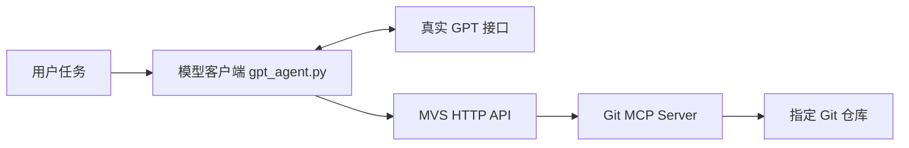

# Linux 部署与真实 GPT、MCP 工具接入教程

> 0.0.1 已提供集成安装器与 shadcn/ui 控制台。面向普通用户优先使用
> [最终用户安装教程](user_installation.md)中的 `mvs init` / `mvs serve`。
> 本文保留源码部署和旧环境变量入口，适合开发者；两套管理方式的数据源独立，不要同时
> 使用同一个端口。旧 YAML 可在控制台服务停止时通过 `mvs config import` 合并导入。

本文把整条链路接起来：**用户任务 → GPT → MVS HTTP API → 真实 MCP Server → 实际工具**。
以 Ubuntu/Debian、单机部署、OpenAI Responses 兼容模型接口和官方 Git MCP Server 为例。
其他 Linux 发行版需要替换系统软件包安装命令。

最终会有三个独立部分：



**先在不调用模型的情况下验证 MCP 工具，再启动 API，最后接 GPT。**
`mvs-benchmark` 是合成任务实验入口，不是连接你的真实服务器和业务数据的入口。
本教程使用新增的 `examples/deploy_api.py` 与 `examples/gpt_agent.py`，后者只调用实际 MVS API。

## 1. 准备目录与运行身份

以下命令在 Linux 的 Bash 终端执行，不要输入 MVS 的 `mvs:/>` 提示符。
示例约定：

| 路径                     | 用途                           |
| ------------------------ | ------------------------------ |
| `/opt/mvs`               | 本项目源码和主虚拟环境         |
| `/opt/mvs/.mcp-git`      | 独立安装 Git MCP Server 的环境 |
| `/srv/mvs/repos/project` | 允许 Git MCP 访问的真实仓库    |
| `/var/lib/mvs/results`   | 结果数据库和对象文件           |
| `/etc/mvs/api.env`       | API 令牌与运行配置             |

有 sudo 权限的管理员执行：

```bash
sudo apt-get update
sudo apt-get install -y git curl ca-certificates jq
sudo useradd --system --create-home --home-dir /var/lib/mvs --shell /bin/bash mvs
sudo install -d -o mvs -g mvs /opt/mvs /srv/mvs/repos /var/lib/mvs/results
sudo install -d -o root -g mvs -m 0750 /etc/mvs
```

如果 `mvs` 用户已存在，跳过 `useradd`。运行账户需要能读取指定 Git 仓库。
建议先用专门准备的仓库，确认工具范围后再换成正式仓库。

## 2. 把项目传到 Linux

目前这个工作区的文件可能尚未提交到 Git，不能假设 `git clone` 会取到当前实现。
可以在开发电脑的项目根目录打包当前源码，排除本机环境、凭证和实验产物：

```bash
tar --exclude=.git --exclude=.venv --exclude=.tools --exclude=.mvs --exclude=.mcp-git --exclude=artifacts --exclude=__pycache__ --exclude=.pytest_cache --exclude=.mypy_cache --exclude=.ruff_cache --exclude='.env*' --exclude=configs/servers.local.yaml -czf ../mvs-source.tar.gz .
scp ../mvs-source.tar.gz your-user@your-server:/tmp/mvs-source.tar.gz
```

Windows PowerShell 也可执行这两条 `tar`、`scp` 命令。请替换登录用户名和服务器地址。
若项目已经提交到你的远程仓库，也可以使用自己的仓库地址克隆到 `/opt/mvs`。
不要复制 Windows 的 `.venv` 到 Linux。

在 Linux 管理员终端解压：

```bash
sudo -u mvs tar -xzf /tmp/mvs-source.tar.gz -C /opt/mvs
sudo -iu mvs
```

下面第 3–5 节在 **mvs 用户终端**执行。

## 3. 安装 uv、Python 和项目依赖

```bash
curl -LsSf https://astral.sh/uv/0.13.8/install.sh -o /tmp/mvs-uv-install.sh
sh /tmp/mvs-uv-install.sh
source /var/lib/mvs/.local/bin/env
uv python install 3.12
cd /opt/mvs
uv sync --locked --no-dev --extra api --extra benchmark --python 3.12
.venv/bin/python --version
```

这里同时安装 API 和模型客户端需要的 HTTP 依赖；`benchmark` 可选依赖提供 httpx，
不表示安装后会自动启动付费实验。`--locked` 使用项目锁文件；示例固定 uv 0.13.8。
安装方法依据 [uv 官方安装文档](https://docs.astral.sh/uv/getting-started/installation/)。

先验证自带演示：

```bash
.venv/bin/mvs --config configs/servers.example.yaml --json exec -- 'run /mcp/demo/tools/add --a 2 --b 3'
```

预期 `status=success`、`data={"result":5}`。这一步不需要模型 API Key。
部署后运行服务时直接使用 `.venv/bin/python`，避免每次启动都重新解析或同步依赖。

## 4. 安装并验证真实 Git MCP Server

本教程使用 **`mcp-server-git==2026.11.11`**。项目主环境与外部 MCP 环境分开安装：

```bash
cd /opt/mvs
uv venv .mcp-git --python 3.12
uv pip install --python .mcp-git/bin/python 'mcp-server-git==2026.11.11'
git --version
.mcp-git/bin/python -m mcp_server_git --help
```

该版本要求 Git 2.31 或以上。本教程采用服务器的 `--repository` 约束仓库访问范围，
工具还需要传入 `repo_path`。依据：[官方 Git MCP 文档](https://github.com/modelcontextprotocol/servers/blob/main/src/git/README.md)。

准备真实仓库有两种方式，任选一种。

**使用已有仓库：** 把你实际可访问的仓库克隆到约定目录。私有仓库凭证由管理员配置，
不要把凭证拼入模型任务文本。

```bash
git clone <你的Git仓库地址> /srv/mvs/repos/project
```

**先用本地练习仓库：** 这仍然通过真实 Git 进程和 MCP 服务读写磁盘，并非模拟工具。
下面只在新建的练习目录产生一次提交。

```bash
mkdir -p /srv/mvs/repos/project
git -C /srv/mvs/repos/project init
printf 'MVS Linux 接入测试\n' > /srv/mvs/repos/project/README.md
git -C /srv/mvs/repos/project add README.md
git -C /srv/mvs/repos/project -c user.name='MVS Demo' -c user.email='mvs-demo@example.invalid' commit -m '初始化练习仓库'
```

安装并准备仓库后，复制项目附带的 Linux 配置：

```bash
cd /opt/mvs
cp configs/servers.linux.example.yaml configs/servers.local.yaml
```

配置内容如下；换目录时同时修改解释器路径、`--repository` 参数和后续命令的 `repo_path`：

```yaml
servers:
  - id: gitrepo
    transport: stdio
    command: /opt/mvs/.mcp-git/bin/python
    args: ["-m", "mcp_server_git", "--repository", "/srv/mvs/repos/project"]
    enabled: true
    trust_level: trusted
    allowed_tools:
      [git_status, git_log, git_show, git_diff_unstaged, git_diff_staged]
    connect_timeout_seconds: 30
    discovery_timeout_seconds: 15
    call_timeout_seconds: 20
    max_concurrency: 2
    refresh_ttl_seconds: 60
```

这里仅授权只读工具；服务器具备的 `git_commit`、`git_add` 等写工具不会自动获得调用权限。
MVS 工具白名单限制“能调用哪些工具”，仓库路径范围则由外部服务器的 `--repository`
和操作系统目录权限共同限制，不能把工具白名单当成路径隔离。

先用命令行查看真实发现结果：

```bash
.venv/bin/mvs --config configs/servers.local.yaml exec -- 'servers'
.venv/bin/mvs --config configs/servers.local.yaml exec -- 'ls /mcp/gitrepo/tools'
.venv/bin/mvs --config configs/servers.local.yaml exec -- 'help /mcp/gitrepo/tools/git_log'
.venv/bin/mvs --config configs/servers.local.yaml --json exec -- 'run /mcp/gitrepo/tools/git_status --repo_path /srv/mvs/repos/project'
.venv/bin/mvs --config configs/servers.local.yaml --json exec -- 'run /mcp/gitrepo/tools/git_log --repo_path /srv/mvs/repos/project --max_count 3'
```

工具名称和参数必须以 `help` 实际发现的内容为准。`max_count` 是整数，复杂或联合参数可改用
`--params-json`。此时已经接通“本项目 → 外部 Git MCP → 真实仓库”，仍不需要模型。
连接超时设置为 30 秒，给子进程启动和 SDK 对旧版协议的探测、回退握手留出时间。

## 5. 先用前台方式启动 API

在 mvs 用户终端设置运行配置；两个令牌分别用于模型客户端和管理监控：

```bash
cd /opt/mvs
export MVS_CONFIG=/opt/mvs/configs/servers.local.yaml
export MVS_ALLOWED_SERVERS=gitrepo
export MVS_STORAGE_ROOT=/var/lib/mvs/results
export MVS_AGENT_TOKEN="$(.venv/bin/python -c 'import secrets; print(secrets.token_urlsafe(32))')"
export MVS_ADMIN_TOKEN="$(.venv/bin/python -c 'import secrets; print(secrets.token_urlsafe(32))')"
.venv/bin/python -m uvicorn examples.deploy_api:create_app_from_env --factory --host 127.0.0.1 --port 8080 --workers 1
```

`examples/deploy_api.py` 不再固定使用 demo。它读取 `MVS_CONFIG`，并显式把
`MVS_ALLOWED_SERVERS` 中的服务器授权给模型主体与管理员。多个服务器用逗号分隔。
令牌必须不同且各不少于 24 字符；默认租户为 `default`，可通过 `MVS_TENANT_ID` 修改。

**不要只改 YAML 却继续使用旧 `examples/api_server.py`**：旧示例仍固定配置和授权 demo。
当前会话存储在进程内，部署必须先用 **单个 worker**。两个身份各自隔离 MCP 客户端，
所以可能启动两份 Git MCP 子进程，这是当前实现的预期行为。

可以在另一终端先检查无认证的健康接口：

```bash
curl --fail http://127.0.0.1:8080/api/v1/health/live
curl --fail http://127.0.0.1:8080/api/v1/health/ready
```

需要执行工具的另一终端必须设置与服务端一致的 `MVS_AGENT_TOKEN`。
前台方式适合排查；持久化令牌和开机启动按下一节处理。

## 6. 使用 systemd 持续运行

先停止前台 uvicorn，避免 8080 端口冲突。退出 mvs 用户终端，回到有 sudo 权限的管理员终端。
使用管理员权限生成环境文件；若文件已存在，脚本会拒绝覆盖，避免无意轮换令牌：

```bash
sudo /opt/mvs/.venv/bin/python - <<'PY'
import os
import secrets

lines = [
    'MVS_CONFIG=/opt/mvs/configs/servers.local.yaml',
    'MVS_ALLOWED_SERVERS=gitrepo',
    'MVS_STORAGE_ROOT=/var/lib/mvs/results',
    'MVS_TENANT_ID=default',
    'MVS_AGENT_TOKEN=' + secrets.token_urlsafe(32),
    'MVS_ADMIN_TOKEN=' + secrets.token_urlsafe(32),
]
fd = os.open('/etc/mvs/api.env', os.O_WRONLY | os.O_CREAT | os.O_EXCL, 0o600)
with os.fdopen(fd, 'w', encoding='utf-8') as stream:
    stream.write('\n'.join(lines) + '\n')
PY
sudo chown root:mvs /etc/mvs/api.env
sudo chmod 0640 /etc/mvs/api.env
sudo install -m 0644 /opt/mvs/deploy/mvs.service /etc/systemd/system/mvs.service
sudo systemctl daemon-reload
sudo systemctl enable --now mvs
sudo systemctl status mvs --no-pager
```

服务使用项目的实际解释器启动，不依赖交互终端的 PATH 或 uv 命令。
查看日志与重启：

```bash
sudo journalctl -u mvs -n 100 --no-pager
sudo systemctl restart mvs
```

修改服务器 YAML、授权列表或令牌后重启 API。TTL 刷新只刷新现有服务器的工具目录，
不会自动重读 YAML 或更新主体授权。重启后内存会话失效，客户端需要重新创建会话。

在 mvs 用户的测试终端可以加载环境文件验证认证访问：

```bash
set -a
source /etc/mvs/api.env
set +a
curl --fail -H "Authorization: Bearer $MVS_AGENT_TOKEN" http://127.0.0.1:8080/api/v1/servers
curl --fail -H "Authorization: Bearer $MVS_ADMIN_TOKEN" http://127.0.0.1:8080/metrics
```

普通模型主体没有 `/metrics` 和管理刷新权限，使用其令牌访问这些接口应返回 403。
如果需要控制台 OTel 追踪，可在环境文件加入 `MVS_TRACE_CONSOLE=1` 后重启。

## 7. 不经过模型，先用 HTTP 完成一次工具调用

以下命令在已加载 `MVS_AGENT_TOKEN` 的 Bash 终端执行：

```bash
export MVS_API_URL=http://127.0.0.1:8080
SESSION_ID=$(curl --fail -sS -X POST "$MVS_API_URL/api/v1/sessions" -H "Authorization: Bearer $MVS_AGENT_TOKEN" -H 'Content-Type: application/json' -d '{}' | jq -r .session_id)
BODY=$(jq -n --arg sid "$SESSION_ID" --arg cmd 'run /mcp/gitrepo/tools/git_log --repo_path /srv/mvs/repos/project --max_count 3' '{session_id:$sid,command:$cmd}')
curl --fail -sS -X POST "$MVS_API_URL/api/v1/shell/execute" -H "Authorization: Bearer $MVS_AGENT_TOKEN" -H 'Content-Type: application/json' -d "$BODY" | jq
curl --fail -sS -X DELETE "$MVS_API_URL/api/v1/sessions/$SESSION_ID" -H "Authorization: Bearer $MVS_AGENT_TOKEN"
```

成功的 HTTP 200 不一定代表工具成功，仍应检查响应中的 `status`、`error` 和 `data`。
取得 `result_ref` 后，同一主体可创建新会话继续读取未过期结果。

## 8. 接入真实 GPT，让模型自主发现和调用

模型客户端负责把自然语言变为 `virtual_shell(command)` 调用，然后把返回数据交回模型。
API 服务端不需要持有模型 Key；模型客户端需要以下配置：

| 配置              | 所在进程     | 用途                             |
| ----------------- | ------------ | -------------------------------- |
| `OPENAI_BASE_URL` | GPT 客户端   | OpenAI 或兼容 Responses 接口地址 |
| `OPENAI_API_KEY`  | GPT 客户端   | 模型调用凭证                     |
| `MVS_API_URL`     | GPT 客户端   | 本项目 API 地址                  |
| `MVS_AGENT_TOKEN` | 两端配置匹配 | 客户端访问 MVS 的普通主体令牌    |
| `MVS_ADMIN_TOKEN` | 管理端       | 监控和管理操作，模型客户端不使用 |

设置你实际可用的模型接口和模型 ID；模型必须支持 **Responses API 的函数工具调用**。
仅兼容 Chat Completions 的接口不能直接用于本示例。

```bash
cd /opt/mvs
export OPENAI_BASE_URL=https://api.openai.com/v1
read -r -s -p '请输入模型 API Key: ' OPENAI_API_KEY
printf '\n'
export OPENAI_API_KEY
export MVS_API_URL=http://127.0.0.1:8080
read -r -p '请输入当前接口可用的 GPT 模型 ID: ' MODEL_ID
.venv/bin/python examples/gpt_agent.py --model "$MODEL_ID" --task '请先发现工具，再读取 /srv/mvs/repos/project 最近3次提交，用中文总结修改内容。不要修改仓库。'
```

`MVS_AGENT_TOKEN` 需要在当前终端设置；若使用上节同一终端，它已经存在。
使用自定义兼容网关时，把 `OPENAI_BASE_URL` 改为该网关地址，并填写它接受的 Key。
本项目之前测通的 `gpt-6-astra` 是特定兼容接口返回的模型标识，不保证你的账户也能使用。

该脚本会：

1. 向 MVS 创建属于当前主体的会话。
2. 只向 GPT 暴露一个 `virtual_shell` 函数。
3. 由 GPT 自行生成 `servers`、`ls`、`help` 和 `run` 等调用。
4. 将命令发给 MVS HTTP API，再把结果包装为不可信工具数据交回模型。
5. 最多运行 8 轮模型响应、16 次虚拟命令，输出中文答案与调用统计，最后关闭会话。

可通过 `--max-rounds`、`--max-tool-calls`、`--max-output-tokens` 调整上限。
发生需要审批、工具超时、服务器离线或协议错误时，脚本停止，不自动重复潜在副作用调用。
输出包含模型返回标识、轮次、已观测 Token、请求标识和结果引用。缺失用量会明确标记。

模型请求会包含你的任务以及工具读取到的仓库内容；请选择适合这些数据的模型服务。
这是实际 API 调用，可能计费。接口字段依据
[OpenAI 官方函数调用文档](https://developers.openai.com/api/docs/guides/function-calling)。

## 9. 接入其他真实 MCP 服务

若要同时暴露本机 Linux/Windows/macOS 原生命令，新增 `transport: native` 分组，并把其 ID
加入 `MVS_ALLOWED_SERVERS`。配置示例与平台差异见[原生命令注册与管理](native_commands.md)。
MCP 在 `/mcp`、原生命令在 `/os`，共用 API 和授权。不要把系统程序误配置成 stdio MCP，
普通程序不会响应 MCP 协议；原生命令也不会为你执行任意 Shell 文本。

### 本地 stdio MCP

先按该 MCP 项目自己的文档安装并验证可执行入口，再新增一项配置：

```yaml
- id: business
  transport: stdio
  command: /opt/business-mcp/.venv/bin/python
  args: ["-m", "business_mcp"]
  env_refs:
    BUSINESS_API_KEY: MVS_BUSINESS_API_KEY
  enabled: true
  allowed_tools: [实际发现的工具名]
```

`env_refs` 左侧是子进程需要的环境变量名，右侧是 MVS 进程中已有的变量名。
在 `/etc/mvs/api.env` 设置 `MVS_BUSINESS_API_KEY`，不要把明文密钥写入 YAML。
配置不会对路径或 args 做 `$VAR` 替换；请使用实际绝对路径。

### 远程 Streamable HTTP MCP

```yaml
- id: remote
  transport: streamable_http
  url: "https://your-mcp.example.com/mcp"
  http_allowed_hosts: ["your-mcp.example.com"]
  auth_ref: MVS_REMOTE_MCP_TOKEN
  enabled: true
  allowed_tools: [实际发现的工具名]
```

把真实 URL、主机名和工具名填入配置，在 API 环境设置 `MVS_REMOTE_MCP_TOKEN`。
`auth_ref` 当前按 **Bearer** 方式发送，不是任意自定义认证头，也不实现 OAuth 浏览器登录与续期。
使用其他认证方式的 MCP 服务需要额外适配。地址必须是 MCP 的 Streamable HTTP 端点，
不能把普通 REST API 地址直接当 MCP 地址。

工具名未知时可先使用管理员可信的只读发现接口，在本机查看元数据，再把需要的工具加入
`allowed_tools`。白名单默认空，不能为了查看目录就给模型任意执行权限。

```bash
cd /opt/mvs
.venv/bin/python - <<'PY'
import asyncio
from mvs.config import load_config
from mvs.infrastructure.mcp.client_manager import ClientManager

async def main():
    manager = ClientManager(load_config('configs/servers.local.yaml'))
    try:
        for item in await manager.list_tools('remote', refresh=True):
            print(item['name'], item['input_schema'])
    finally:
        await manager.close()

asyncio.run(main())
PY
```

这是管理员终端操作，`remote` 请换成实际服务器 ID。补齐白名单后，将 `MVS_ALLOWED_SERVERS`
改为 `gitrepo,remote` 并重启。先用 CLI/API 验证，再让 GPT 尝试。

## 10. 远程访问、常见问题与验证范围

默认 API 仅监听回环地址。如果模型客户端在你的电脑上，可使用 SSH 隧道：

```bash
ssh -N -L 8080:127.0.0.1:8080 your-user@your-server
```

电脑上的 `MVS_API_URL` 仍填 `http://127.0.0.1:8080`，并设置相同的普通主体令牌。
需要公网部署时，应在前面配置 HTTPS 反向代理；客户端示例拒绝向非本机的明文 HTTP
地址发送 MVS 令牌。`systemd` 示例用于单机持续运行，不代表分布式生产能力已经补齐。

| 现象                           | 检查项                                                                |
| ------------------------------ | --------------------------------------------------------------------- |
| `uv: command not found`        | 是否在正确用户下安装并加载 uv 环境；服务本身直接用 `.venv/bin/python` |
| `SERVER_OFFLINE` 或就绪接口503 | 解释器绝对路径、MCP安装、仓库存在与权限、启动超时、服务器日志         |
| `ls /mcp` 没有新服务           | 是否使用 deploy_api；`MVS_ALLOWED_SERVERS` 是否包含该 ID；是否重启    |
| 工具不存在或 NOT_FOUND         | `allowed_tools`、路径、主体授权和真实工具名；不是只有 Schema 验证     |
| `INVALID_ARGUMENT`             | 先查看 help；联合参数用 `--params-json`；不要猜参数名                 |
| API 401                        | 两端令牌是否一致、Bearer头是否正确、是否因重新生成环境文件换了令牌    |
| API 403                        | 普通主体访问了监控/管理接口；该操作需管理员令牌                       |
| 模型400/404                    | 地址是否支持 `/v1/responses`，模型ID和reasoning参数是否被当前账户接受 |
| 模型502/超时                   | 查看模型网关状态；不要把基础设施错误当成工具或业务结果                |
| 会话突然404                    | API重启或多个worker导致会话不在当前进程；先固定单worker并重新建会话   |

**验证范围：** 教程配套入口有自动化测试；测试用可控模型响应验证循环和停止行为，
后端通过真实 stdio MCP 执行。官方 Git MCP 使用固定版本单独联调。
本机 Ubuntu/WSL 中已使用 `bash -n` 检查全部 20 段 Bash 示例的语法。
本次教程相关 6 项测试通过，全量回归 121 项通过；Ruff 和 mypy 检查通过。
开发环境如需复现教程接入测试，先安装开发依赖，再显式指定 Git MCP 解释器：

```bash
cd /opt/mvs
uv sync --locked --all-extras
MVS_GIT_MCP_PYTHON=/opt/mvs/.mcp-git/bin/python uv run pytest tests/e2e/test_deployment_examples.py -q
```

缺少该隔离解释器时，官方 Git MCP 联调测试会明确跳过；CI 已配置自动安装对应版本。
本轮不重新调用付费 GPT、不登录你的 Linux 服务器；具体系统安装与 systemd 启动仍需在
目标机器执行。本机 Ubuntu/WSL 可启动，但当前 DNS 解析失败，不能据此声称 Linux
依赖安装和完整服务部署已经实测通过。最新真实 GPT 实测见[模型实验报告](../../artifacts/benchmarks/gpt-240-20261125-185218-v0.0.1/report.md)。

剩余生产限制包括 OAuth 生命周期、分布式会话/限流、硬性 CPU 隔离和 DNS 连接绑定，
详见[安全边界](../reference/security.md)。监控配置见[可观测性说明](../reference/observability.md)。
